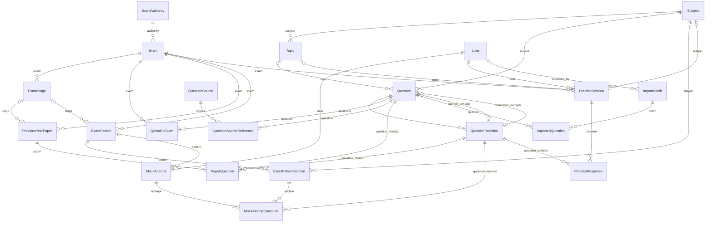

# Database design

The optional shared question hierarchy adds Part (Subject FK), Module (Part FK),
Chapter (Module FK) and Topic.chapter (nullable FK). Existing Topic.subject and
Question links remain. See [hierarchy constraints and ERD](question-taxonomy.md).

Milestone 3.1 administrative completion / D24 adds optional PreviousYearPaper
duration_minutes, total_marks (decimal), instructions, subject FK PROTECT and
expected_question_count. Database checks enforce positive optional duration/count
and nonnegative marks. Actual count is derived from PaperQuestion; transactional
publication verifies the declared count and subject consistency. No master or
translation records are duplicated. See [paper administration](previous-year-administration.md).

## Milestone 2.3C additions (supersede older language-only descriptions)

Question adds shared working `correct_answer` (A/B/C/D; blank only before an
initial revision) and optional `difficulty_level`. QuestionRevision snapshots
shared answer/difficulty; existing primary-language content remains compatible.
QuestionTranslation: id PK, question FK PROTECT → Question, revision FK PROTECT →
QuestionRevision, language, question_text, option_a/b/c/d, explanation optional.
Unique (revision, language); language-code and required-content check constraints.
The derived language rows are immutable and must belong to their master/revision.
Use the new-revision/translation services rather than direct/bulk mutation.
Migration 0003 backfills each existing revision without merging Question IDs or
changing paper references. See [detailed design](multilingual-questions.md).

Authority: approved Phase 0 **Database & Import Specification v1.0**, with clarifications D17–D19 in [decisions](decisions.md). User, exam taxonomy, Question Bank, and Previous Year Paper models are implemented through Milestone 3.1; other domain models remain target design. PostgreSQL UTF-8 is mandatory for development and tests.

Notation: `PK` primary key; `FK` foreign key; `?` explicitly nullable/optional. Implemented models use surrogate BigAutoField PKs, including QuestionExam, QuestionSourceReference, and PaperQuestion. Existing User inherits AbstractUser fields, groups, and permissions.

## Approved model inventory

| App / model | Fields and relationships | Approved uniqueness |
|---|---|---|
| `accounts.User` | Existing AbstractUser; target of user/uploaded_by FKs | Inherited Django username uniqueness |
| `exams.ExamAuthority` | id PK, name, code, slug, is_active | code; slug |
| `exams.Exam` | id PK, authority FK → ExamAuthority, name, code, slug, is_active | (authority, code); (authority, slug), approved in Milestone 2.1 |
| `exams.ExamStage` | id PK, exam FK → Exam, name, code, display_order | (exam, code) |
| `exams.Subject` | id PK, name, code, slug | code; slug, approved in Milestone 2.1 |
| `exams.Topic` | id PK, subject FK → Subject, name, slug | (subject, slug) |
| `questions.Question` | id PK, source_question_id?, subject FK → Subject, topic? FK → Topic, publication_status (draft/published), review_status (pending_review/reviewed), current_revision? FK → QuestionRevision (working), published_revision? FK → QuestionRevision (live), created_at, updated_at | External IDs unique within their defined source scope, not globally; scope unresolved, not enforced globally |
| `questions.QuestionRevision` | id PK, question FK → Question, revision_number, language (en/bn), question_text, option_a/b/c/d, correct_answer (A/B/C/D), explanation optional, created_at, published_at? (permanent publication marker) | (question, revision_number) |
| `questions.QuestionExam` | question FK → Question, exam FK → Exam | (question, exam) |
| `questions.QuestionSource` | id PK, source_name, source_document, created_at | Not specified |
| `questions.QuestionSourceReference` | question FK → Question, source FK → QuestionSource, source_page?, source_question_number? | Not specified |
| `previous_year.PreviousYearPaper` | id PK, exam FK → Exam, stage? FK → ExamStage, year, paper_name, part, session, is_published, created_at | (exam, stage, year, paper_name, part, session), including nullable-field handling |
| `previous_year.PaperQuestion` | id PK, paper FK → PreviousYearPaper, question_revision FK → QuestionRevision, derived question FK → Question (Milestone 3.1), question_number (string), display_order (positive integer) | (paper, display_order); (paper, question_number); (paper, question) |
| `mock_tests.ExamPattern` | id PK, exam FK → Exam, stage? FK → ExamStage, name, version, total_questions, duration_minutes, default_positive_marks, default_negative_marks, is_active, created_at | Exactly one active pattern per exam/stage; version uniqueness key not specified |
| `mock_tests.ExamPatternSection` | id PK, pattern FK → ExamPattern, subject FK → Subject, name, question_count, language_mode (en/bn/mixed), positive_marks?, negative_marks?, display_order | Not specified |
| `mock_tests.MockAttempt` | id PK, user FK → User, pattern FK → ExamPattern, started_at, expires_at, submitted_at, status (in_progress/submitted/expired), total_score, maximum_score, correct_count, incorrect_count, unanswered_count | Not specified |
| `mock_tests.MockAttemptQuestion` | id PK, attempt FK → MockAttempt, section FK → ExamPatternSection, question_revision FK → QuestionRevision, display_order, selected_answer?, positive_marks, negative_marks, awarded_marks, answered_at? | (attempt, display_order); no repeated Question identity per attempt |
| `practice.PracticeSession` | id PK, user FK → User, exam FK → Exam, subject? FK → Subject, topic? FK → Topic, started_at, completed_at, status | Not specified |
| `practice.PracticeResponse` | id PK, session FK → PracticeSession, question_revision FK → QuestionRevision, display_order, selected_answer, is_correct, answered_at | No repeated Question identity per session; exact constraint not specified |
| `imports.ImportBatch` | id PK, uploaded_by FK → User, filename, file_sha256, context_sha256, staging_token UUID, mapping_version, status, row_count, error_count, paper? FK → PreviousYearPaper, mapping_metadata JSON, created_at, confirmed_at | (file_sha256, context_sha256); staging_token (Milestone 2.3B / D21) |
| `imports.ImportedQuestion` | id PK, batch FK → ImportBatch, source_row_number, question FK → Question, action, source_metadata JSON (original/corrected values) | (batch, source_row_number) |

ExamStage references are always optional. A Topic must match its Question's Subject, and a stage must belong to the selected exam. The source does not specify every field type, length, default, or nullability; absence of `?` here does not settle lifecycle nullability (for example submitted_at before submission).

## Relationships and integrity

Milestone 3.1 implements PreviousYearPaper/PaperQuestion. Paper identity trims textual values and compares them case-insensitively; optional blank part/session normalize to NULL. Expression uniqueness coalesces nullable identity components. New associations use approved live revisions and matching QuestionExam membership; stored historical published revisions remain valid after newer Question Bank publication. Publication is explicit, transactional, nonempty, and revalidated. Published papers must be unpublished before edits. The derived PaperQuestion.question FK enables identity uniqueness across different revisions; validated saves derive it from question_revision. See D18 in [decisions](decisions.md). Imports/deduplication remain deferred (D19).

Question↔Exam is many-to-many through QuestionExam. Question↔QuestionSource is many-to-many through QuestionSourceReference. PreviousYearPaper↔QuestionRevision is many-to-many through PaperQuestion, preserving paper-local numbering and order. Patterns have sections; attempts and practice sessions have ordered response rows. Question has multiple revisions and a separate nullable current_revision pointer.

Milestone 2.2 adds a separate published_revision pointer and published_at marker (D17). Default state is draft/pending_review. The review state describes the working revision; a pending draft may coexist with an older approved live revision. Both pointers must belong to their Question. Services lock the Question before allocating revision numbers or changing workflow state; new content always creates a revision. Database checks enforce status enums, published-pointer presence, positive revision numbers, language/answer enums, and nonempty content. Model validation enforces non-whitespace content, topic/subject consistency, pointer ownership, and fixed language. All Question Bank FKs use PROTECT. Revision writes/deletions and workflow bulk writes are guarded; public queries select only valid marked live revisions. Composite revision/exam indexes cover their leading FK columns, so redundant standalone FK indexes are disabled.

Use FK and uniqueness constraints, plus check constraints for language/answer values, positive counts/duration, and nonnegative penalties. Negative marks are positive-or-zero penalty amounts. Cross-row pattern validation and publication use transactional services. Public papers must be published and reference revisions approved for publication.

### Pattern activation

- Exactly one active pattern per exam/stage, including the no-stage scope; the precise database enforcement mechanism is not specified.
- Section counts must sum to total_questions; counts and duration must be positive.
- Check published-question availability for each section before activation, respecting subject and language mode. Mixed permits en and bn without fixed proportions.
- Nullable section marks use pattern defaults; save effective values on attempt questions.
- Pattern versions referenced by attempts cannot be modified. There is no student language selector.

### Historical attempt integrity

Published revisions are immutable; language is constant across a Question's revisions. Use PROTECT for historical revisions and referenced patterns. Persist selected revisions, order, and effective scoring values at attempt creation. Prevent duplicate Question identities even if different revisions exist. Enforce timing, autosave, expiry, and scoring on the server; reject changes after submission or expiry. Blank answers score zero; score equals correct marks minus incorrect penalties. Hide answer keys before submission. Preserve completed attempts and results permanently unless an explicit retention policy is approved. Other FK deletion policies are not specified.

## Recommended indexes

Phase 0 recommends these access paths; do not add redundant indexes already covered by PKs, FKs, or unique constraints:

| Model | Columns |
|---|---|
| Question | (publication_status, subject) |
| QuestionRevision | (question, revision_number), already covered by uniqueness |
| QuestionExam | (exam, question) |
| PreviousYearPaper | (exam, year) |
| PaperQuestion | (paper, display_order), already covered by uniqueness |
| ExamPattern | (exam, is_active) |
| MockAttempt | (user, started_at); (status, expires_at) |
| PracticeResponse | (session, display_order) |
| ImportBatch | (file_sha256) |

## Relational ERD

Lines show FK relationships; optional parent links are marked `o|`. Attribute details and unspecified join-model PKs are covered above. Django's inherited authentication tables are omitted.

## Details requiring approval before relevant implementation

Source-ID scope/key and its link to source associations; exact source-metadata audit field, bounds, and schema; status/action enums for imports and practice; field types/lengths/decimal precision/defaults/nullability not given above; paper nullable-field normalization and enforcement; pattern version uniqueness and concurrent activation enforcement; exact duplicate-identity enforcement across revision rows; unspecified deletion policies. These are open implementation details, not additional approved models or constraints.

Milestone 2.3B/D21: ImportBatch.paper is nullable for General Question Bank imports.
Migration 0002 backfills historical context hashes and scopes file uniqueness by
(file_sha256, context_sha256). Staging UUID remains globally unique. No Question
Bank or Previous Year model integrity constraint is weakened; missing answer,
subject or language blocks confirmation until explicitly resolved.

GeneralQuestionBatch (general_question, D22) is an admin proxy for completed
General ImportBatch records, not a separate table. Its inherited PK/fields and
ImportedQuestion relationships point to the existing import audit records.
Question identity/content and immutable revisions remain in questions.

## Milestone 4.1 implementation (2026-11-05)

`mock_tests.ExamPattern` now stores Exam, optional Stage, name, descriptive
version (default 1), duration_minutes, total_questions, total_marks,
default_positive_marks, default_negative_marks, status (draft/active/inactive),
and created_at. Status replaces the proposed stored is_active flag; is_active
is a derived Python property. Version uniqueness remains unspecified.

`ExamPatternSection` stores pattern, name, unique per-pattern display_order,
question_count, optional Subject/Topic, language_mode (en/bn/mixed), and nullable
positive_marks/negative_marks overrides. Topic must match Subject when both are
specified. All foreign keys use PROTECT. Counts, duration, version and positive
marks must be positive; negative marks are nonnegative deduction amounts.
Unanswered questions will score zero. Maximum section marks must sum to total_marks.

Explicit transactional services activate/deactivate patterns, locking the Exam
and pattern. Partial PostgreSQL uniqueness constraints allow one active pattern
per Exam/Stage, including a separate no-stage scope. Active configuration and
sections are read-only; deactivate before edits. Availability uses each master
Question's approved published revision and valid available translations, matching
Exam/Subject/Topic/language. A newer working draft does not replace approved content.
Overlapping section pools must support sufficient distinct master questions;
capacity validation does not generate tests or select questions. Availability is
checked at activation, not reserved; the future generation service must revalidate.
No attempts, timers, responses, scoring or results are implemented in 4.1.

## Milestone 4.2 implementation (2026-11-05)

`MockAttempt` stores user and pattern (PROTECT), created_at, started_at, status
(created/in_progress/submitted/expired), and immutable configuration JSON. The
snapshot contains pattern/version, exam/authority/stage labels, duration, totals,
section IDs/names/order/filters/language and effective marks as decimal strings.
There are no answer keys in configuration JSON. Start atomically assembles a
Created attempt and question rows, then marks it In Progress with started_at.
Submitted/Expired state values are reserved; no submission/expiry service exists
yet. Timer enforcement and scoring remain Milestone 4.3.

`AttemptQuestion` implements the planned MockAttemptQuestion relationship without
a second model/table: attempt, section, master Question and QuestionRevision
(PROTECT), display_order, positive_marks and negative_marks. Database uniqueness
covers (attempt, display_order) and (attempt, question); order/positive marks are
positive and deductions nonnegative. Revision ownership and section/pattern
consistency are validated. Revision/translation content is reused, never copied
into mutable question records. Attempt/question snapshots reject edits/deletes.

Starting locks the user, pattern/sections and candidate master questions in
consistent order. Eligibility is rechecked against locked masters before random
selection. The section-capacity flow also allocates distinct master questions
across overlapping pools. Any failure rolls back the full attempt and rows.
An open-attempt uniqueness constraint covers (user, pattern) for Created and
In Progress, supplementing user-row locking for repeated/concurrent requests.
Repeated starts resume that attempt without generation, including after pattern
deactivation. Once used, pattern configuration and sections remain frozen; status
can still change. Create a new pattern version for revised configuration.

All mock navigation requires authentication. Only valid active patterns under
active exams/authorities appear. Attempt retrieval is scoped to the current user
and uses pinned revisions, English-first prefetched translations, and snapshot
labels. Active attempt HTML contains neither correct answers nor explanations.
Start is POST/CSRF protected; GET only displays confirmation or resumes. No answer
entry/autosave, timers, scoring, results or client language selector is added.

## Milestone 4.3 execution fields (2026-11-05)

Existing MockAttempt/AttemptQuestion are extended, not replaced. Attempts add
expires_at (backfilled from frozen duration), finalized_at, last_position,
save_version/token, Decimal total/maximum scores, correct/incorrect/unanswered
counts and section_results JSON. Rows add A-D/blank selected_answer, review flag,
answered_at and awarded_marks. Constraints validate options, deadline/position and
finalization fields. Score fields allow negative totals; deductions stay nonnegative.
Parent-row locking serializes autosave and idempotent finalization. Global
optimistic versions reject stale requests; UUID tokens make retries idempotent.
Immutable configuration/revision/order/marking snapshots remain unchanged.
See [execution workflow and idle-expiry behavior](mock-test-execution.md).

## Milestone 5.1 practice implementation (2026-11-05)

The planned PracticeResponse is implemented as PracticeQuestion, with no second
response model. PracticeSession has owner, exam, required subject, optional topic,
start_token, immutable configuration JSON, status (in_progress/completed/abandoned),
started_at and completed_at. Subject is required by this milestone's navigation.
PracticeQuestion has session, master question, pinned revision, positive display_order,
frozen classification JSON, selected_answer, nullable is_correct and answered_at.
Unique constraints: (user, start_token), (session, question), (session, display_order).
Checks enforce coherent session/answer states. Foreign keys use PROTECT.

Creation and feedback are transactional/idempotent. User/candidate locks protect
creation; parent-session locks serialize answers and abandonment. Submitted answers
are immutable. Completion occurs automatically after the last response; pause retains
in_progress. Question correctness comes from pinned immutable revisions. Classification
snapshots keep historical topic/subject breakdowns consistent after taxonomy edits.
Shared Question Bank eligibility is reused by mocks and practice without changing
mock section allocation. See [practice workflow](practice-sessions.md).
