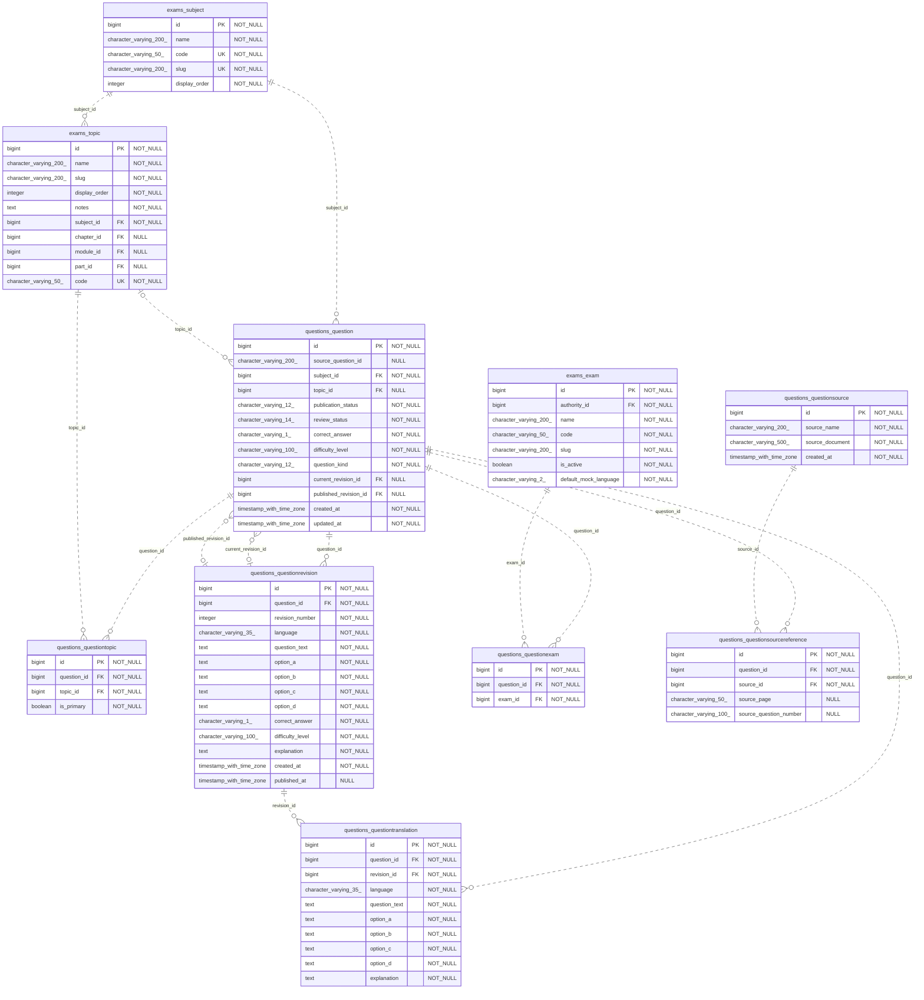
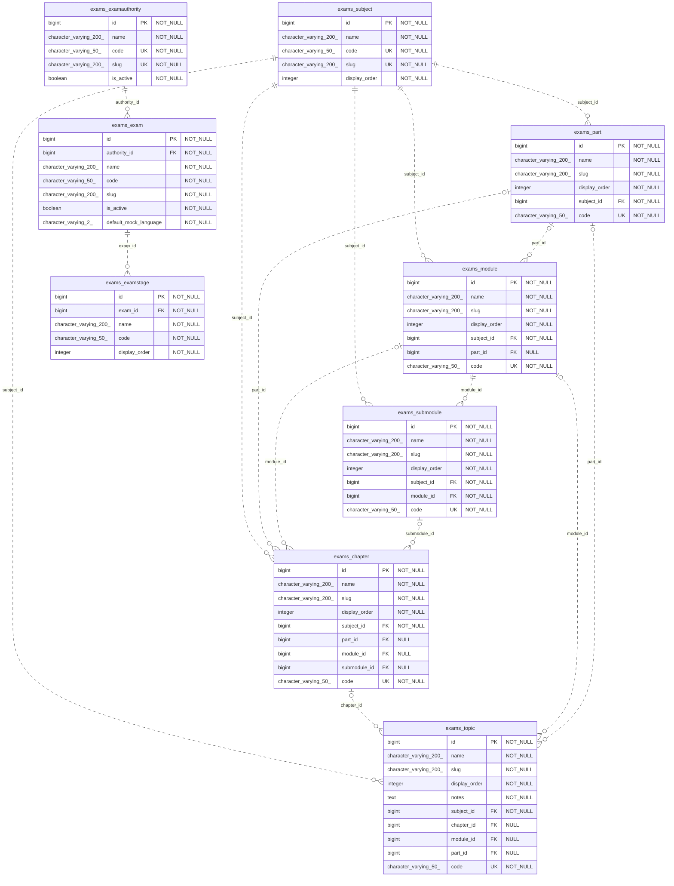

# Questions module ERD

Source and local PostgreSQL schema verified on 2026-11-17. Schema metadata only; no application records were read.

[Open the offline interactive diagram](questions-erd.html) · [Machine-readable schema](questions-schema.json)

All columns are shown for 7 Questions-owned tables, 9 taxonomy/catalogue tables, 8 direct inbound consumer tables, and 5 further mock tables. Other referenced tables appear as boundary keys where needed.

PK = primary key; FK = foreign key; nullable = SQL NULL permitted. Cardinality is derived from physical FKs and uniqueness, not workflow assumptions. Arrows in HTML point from child FK to parent. Mermaid uses crow’s-foot cardinality.

Django `on_delete` policy and SQL FK action are different: the policies below describe ORM deletion; actual PostgreSQL constraints/indexes/triggers are listed separately. `blank` and choices are application validation metadata, not database nullability.

## Schema changes since the previous ERD

- `questions.0006_question_kind` adds `Question.question_kind` with Logical, Static and Unclassified values.
- `mock_tests.0009_question_kind` adds the Any, Logical or Static filter to `SectionSelectionRule`. Any is stored as an empty string.
- `exams.0011_default_mock_language` adds `Exam.default_mock_language`. It sets English for WBCS and Bengali for the other WBPSC exams.

## Relationships to review

- Question is the shared master identity. Its current_revision_id and published_revision_id are nullable FK pointers, not unique/one-to-one columns. Each pointed-to revision must belong to that master (workflow validation).
- QuestionRevision contains primary-language compatibility text plus the shared correct answer/difficulty. Its content is append-only through model/services. QuestionTranslation stores immutable per-revision language content; correct_answer is a Python property inherited from Revision, not a translation column.
- Question.topic_id mirrors the primary QuestionTopic tag. The pair (question_id, topic_id) is unique; a partial unique index allows at most one primary per question. Deferred database triggers require a primary tag matching the pointer whenever tags exist. Unclassified questions may have neither.
- Question.topics, Question.exams and Question.sources are M2M fields backed by the three explicit join tables shown. There are no additional implicit M2M tables for these fields.
- QuestionSourceReference has page/source-number metadata and no unique Question/Source pair constraint. Multiple references for one pair are possible. QuestionSource document/name fields are not unique.
- PaperQuestion, AttemptQuestion and PracticeQuestion pin a revision alongside the master Question. ImportedQuestion, ManualRuleQuestion and SavedQuestion reference the master. SavedQuestion.question uses CASCADE; all other direct inbound Question/Revision FKs use PROTECT.
- A subject is shared across exams; there is no direct Subject/Exam join. QuestionExam establishes membership. Taxonomy nodes store a subject anchor plus at most one immediate parent; intermediate levels may be skipped. Submodule requires Module. Legacy Topics may lack a Chapter.
- JSON/JSONB columns contain snapshots or audit metadata; their internal values are not physical FK relationships and are not drawn as such.
- GeneralQuestionBatch and RevisionSession are proxies, not additional tables. Generic admin log references are not database FKs to Question.

## ERD diagrams

### Core



### Taxonomy



### Consumers

```mermaid
erDiagram
    questions_question {
        bigint id PK "NOT_NULL"
        character_varying_200_ source_question_id "NULL"
        bigint subject_id FK "NOT_NULL"
        bigint topic_id FK "NULL"
        character_varying_12_ publication_status "NOT_NULL"
        character_varying_14_ review_status "NOT_NULL"
        character_varying_1_ correct_answer "NOT_NULL"
        character_varying_100_ difficulty_level "NOT_NULL"
        character_varying_12_ question_kind "NOT_NULL"
        bigint current_revision_id FK "NULL"
        bigint published_revision_id FK "NULL"
        timestamp_with_time_zone created_at "NOT_NULL"
        timestamp_with_time_zone updated_at "NOT_NULL"
    }
    questions_questionrevision {
        bigint id PK "NOT_NULL"
        bigint question_id FK "NOT_NULL"
        integer revision_number "NOT_NULL"
        character_varying_35_ language "NOT_NULL"
        text question_text "NOT_NULL"
        text option_a "NOT_NULL"
        text option_b "NOT_NULL"
        text option_c "NOT_NULL"
        text option_d "NOT_NULL"
        character_varying_1_ correct_answer "NOT_NULL"
        character_varying_100_ difficulty_level "NOT_NULL"
        text explanation "NOT_NULL"
        timestamp_with_time_zone created_at "NOT_NULL"
        timestamp_with_time_zone published_at "NULL"
    }
    billing_freequestionusage {
        bigint id PK "NOT_NULL"
        bigint user_id FK "NOT_NULL"
        bigint question_id FK "NOT_NULL"
        timestamp_with_time_zone delivered_at "NOT_NULL"
    }
    imports_importedquestion {
        bigint id PK "NOT_NULL"
        bigint batch_id FK "NOT_NULL"
        integer source_row_number "NOT_NULL"
        bigint question_id FK "NOT_NULL"
        character_varying_20_ action "NOT_NULL"
        jsonb source_metadata "NOT_NULL"
    }
    mock_tests_attemptquestion {
        bigint id PK "NOT_NULL"
        bigint attempt_id FK "NOT_NULL"
        bigint section_id FK "NOT_NULL"
        bigint question_id FK "NOT_NULL"
        bigint question_revision_id FK "NOT_NULL"
        integer display_order "NOT_NULL"
        numeric_8_2_ positive_marks "NOT_NULL"
        numeric_8_2_ negative_marks "NOT_NULL"
        character_varying_1_ selected_answer "NOT_NULL"
        boolean marked_for_review "NOT_NULL"
        timestamp_with_time_zone answered_at "NULL"
        numeric_10_2_ awarded_marks "NULL"
    }
    mock_tests_manualrulequestion {
        bigint id PK "NOT_NULL"
        bigint rule_id FK "NOT_NULL"
        bigint question_id FK "NOT_NULL"
        integer display_order "NOT_NULL"
    }
    mock_tests_mocksetquestion {
        bigint id PK "NOT_NULL"
        bigint mock_set_id FK "NOT_NULL"
        bigint section_id FK "NOT_NULL"
        bigint question_id FK "NOT_NULL"
        bigint question_revision_id FK "NOT_NULL"
        integer display_order "NOT_NULL"
        numeric_8_2_ positive_marks "NOT_NULL"
        numeric_8_2_ negative_marks "NOT_NULL"
    }
    practice_practicequestion {
        bigint id PK "NOT_NULL"
        bigint session_id FK "NOT_NULL"
        bigint question_id FK "NOT_NULL"
        bigint question_revision_id FK "NOT_NULL"
        integer display_order "NOT_NULL"
        jsonb classification "NOT_NULL"
        character_varying_1_ selected_answer "NOT_NULL"
        boolean is_correct "NULL"
        timestamp_with_time_zone answered_at "NULL"
    }
    previous_year_paperquestion {
        bigint id PK "NOT_NULL"
        bigint paper_id FK "NOT_NULL"
        bigint question_revision_id FK "NOT_NULL"
        bigint question_id FK "NOT_NULL"
        character_varying_100_ question_number "NOT_NULL"
        integer display_order "NOT_NULL"
    }
    revision_savedquestion {
        bigint id PK "NOT_NULL"
        bigint user_id FK "NOT_NULL"
        bigint question_id FK "NOT_NULL"
        timestamp_with_time_zone saved_at "NOT_NULL"
        text personal_note "NOT_NULL"
        timestamp_with_time_zone reviewed_at "NULL"
        integer review_count "NOT_NULL"
        boolean is_mastered "NOT_NULL"
    }
    accounts_user {
        bigint id PK "BOUNDARY_ONLY"
    }
    exams_subject {
        bigint id PK "BOUNDARY_ONLY"
    }
    exams_topic {
        bigint id PK "BOUNDARY_ONLY"
    }
    imports_importbatch {
        bigint id PK "BOUNDARY_ONLY"
    }
    mock_tests_exampatternsection {
        bigint id PK "BOUNDARY_ONLY"
    }
    mock_tests_mockattempt {
        bigint id PK "BOUNDARY_ONLY"
    }
    mock_tests_mockset {
        bigint id PK "BOUNDARY_ONLY"
    }
    mock_tests_sectionselectionrule {
        bigint id PK "BOUNDARY_ONLY"
    }
    practice_practicesession {
        bigint id PK "BOUNDARY_ONLY"
    }
    previous_year_previousyearpaper {
        bigint id PK "BOUNDARY_ONLY"
    }
    exams_subject ||..o{ questions_question : "subject_id"
    exams_topic o|..o{ questions_question : "topic_id"
    questions_questionrevision o|..o{ questions_question : "current_revision_id"
    questions_questionrevision o|..o{ questions_question : "published_revision_id"
    questions_question ||..o{ questions_questionrevision : "question_id"
    accounts_user ||..o{ billing_freequestionusage : "user_id"
    questions_question ||..o{ billing_freequestionusage : "question_id"
    imports_importbatch ||..o{ imports_importedquestion : "batch_id"
    questions_question ||..o{ imports_importedquestion : "question_id"
    mock_tests_mockattempt ||..o{ mock_tests_attemptquestion : "attempt_id"
    mock_tests_exampatternsection ||..o{ mock_tests_attemptquestion : "section_id"
    questions_question ||..o{ mock_tests_attemptquestion : "question_id"
    questions_questionrevision ||..o{ mock_tests_attemptquestion : "question_revision_id"
    mock_tests_sectionselectionrule ||..o{ mock_tests_manualrulequestion : "rule_id"
    questions_question ||..o{ mock_tests_manualrulequestion : "question_id"
    mock_tests_mockset ||..o{ mock_tests_mocksetquestion : "mock_set_id"
    mock_tests_exampatternsection ||..o{ mock_tests_mocksetquestion : "section_id"
    questions_question ||..o{ mock_tests_mocksetquestion : "question_id"
    questions_questionrevision ||..o{ mock_tests_mocksetquestion : "question_revision_id"
    practice_practicesession ||..o{ practice_practicequestion : "session_id"
    questions_question ||..o{ practice_practicequestion : "question_id"
    questions_questionrevision ||..o{ practice_practicequestion : "question_revision_id"
    previous_year_previousyearpaper ||..o{ previous_year_paperquestion : "paper_id"
    questions_questionrevision ||..o{ previous_year_paperquestion : "question_revision_id"
    questions_question ||..o{ previous_year_paperquestion : "question_id"
    accounts_user ||..o{ revision_savedquestion : "user_id"
    questions_question ||..o{ revision_savedquestion : "question_id"
```



### Mocks

```mermaid
erDiagram
    questions_question {
        bigint id PK "NOT_NULL"
        character_varying_200_ source_question_id "NULL"
        bigint subject_id FK "NOT_NULL"
        bigint topic_id FK "NULL"
        character_varying_12_ publication_status "NOT_NULL"
        character_varying_14_ review_status "NOT_NULL"
        character_varying_1_ correct_answer "NOT_NULL"
        character_varying_100_ difficulty_level "NOT_NULL"
        character_varying_12_ question_kind "NOT_NULL"
        bigint current_revision_id FK "NULL"
        bigint published_revision_id FK "NULL"
        timestamp_with_time_zone created_at "NOT_NULL"
        timestamp_with_time_zone updated_at "NOT_NULL"
    }
    questions_questionrevision {
        bigint id PK "NOT_NULL"
        bigint question_id FK "NOT_NULL"
        integer revision_number "NOT_NULL"
        character_varying_35_ language "NOT_NULL"
        text question_text "NOT_NULL"
        text option_a "NOT_NULL"
        text option_b "NOT_NULL"
        text option_c "NOT_NULL"
        text option_d "NOT_NULL"
        character_varying_1_ correct_answer "NOT_NULL"
        character_varying_100_ difficulty_level "NOT_NULL"
        text explanation "NOT_NULL"
        timestamp_with_time_zone created_at "NOT_NULL"
        timestamp_with_time_zone published_at "NULL"
    }
    exams_exam {
        bigint id PK "NOT_NULL"
        bigint authority_id FK "NOT_NULL"
        character_varying_200_ name "NOT_NULL"
        character_varying_50_ code "NOT_NULL"
        character_varying_200_ slug "NOT_NULL"
        boolean is_active "NOT_NULL"
        character_varying_2_ default_mock_language "NOT_NULL"
    }
    mock_tests_attemptquestion {
        bigint id PK "NOT_NULL"
        bigint attempt_id FK "NOT_NULL"
        bigint section_id FK "NOT_NULL"
        bigint question_id FK "NOT_NULL"
        bigint question_revision_id FK "NOT_NULL"
        integer display_order "NOT_NULL"
        numeric_8_2_ positive_marks "NOT_NULL"
        numeric_8_2_ negative_marks "NOT_NULL"
        character_varying_1_ selected_answer "NOT_NULL"
        boolean marked_for_review "NOT_NULL"
        timestamp_with_time_zone answered_at "NULL"
        numeric_10_2_ awarded_marks "NULL"
    }
    mock_tests_manualrulequestion {
        bigint id PK "NOT_NULL"
        bigint rule_id FK "NOT_NULL"
        bigint question_id FK "NOT_NULL"
        integer display_order "NOT_NULL"
    }
    mock_tests_mocksetquestion {
        bigint id PK "NOT_NULL"
        bigint mock_set_id FK "NOT_NULL"
        bigint section_id FK "NOT_NULL"
        bigint question_id FK "NOT_NULL"
        bigint question_revision_id FK "NOT_NULL"
        integer display_order "NOT_NULL"
        numeric_8_2_ positive_marks "NOT_NULL"
        numeric_8_2_ negative_marks "NOT_NULL"
    }
    mock_tests_exampattern {
        bigint id PK "NOT_NULL"
        bigint exam_id FK "NOT_NULL"
        bigint stage_id FK "NULL"
        character_varying_200_ name "NOT_NULL"
        integer version "NOT_NULL"
        integer duration_minutes "NOT_NULL"
        integer total_questions "NOT_NULL"
        numeric_10_2_ total_marks "NOT_NULL"
        numeric_8_2_ default_positive_marks "NOT_NULL"
        numeric_8_2_ default_negative_marks "NOT_NULL"
        character_varying_10_ status "NOT_NULL"
        boolean is_free_demo "NOT_NULL"
        timestamp_with_time_zone created_at "NOT_NULL"
    }
    mock_tests_exampatternsection {
        bigint id PK "NOT_NULL"
        bigint pattern_id FK "NOT_NULL"
        character_varying_200_ name "NOT_NULL"
        integer display_order "NOT_NULL"
        integer question_count "NOT_NULL"
        bigint subject_id FK "NULL"
        bigint topic_id FK "NULL"
        character_varying_5_ language_mode "NOT_NULL"
        numeric_8_2_ positive_marks "NULL"
        numeric_8_2_ negative_marks "NULL"
    }
    mock_tests_sectionselectionrule {
        bigint id PK "NOT_NULL"
        bigint section_id FK "NOT_NULL"
        bigint subject_id FK "NULL"
        bigint part_id FK "NULL"
        bigint module_id FK "NULL"
        bigint chapter_id FK "NULL"
        bigint topic_id FK "NULL"
        integer question_count "NOT_NULL"
        character_varying_12_ difficulty "NOT_NULL"
        character_varying_12_ question_kind "NOT_NULL"
        character_varying_6_ selection_mode "NOT_NULL"
        integer display_order "NOT_NULL"
    }
    mock_tests_mockset {
        bigint id PK "NOT_NULL"
        bigint pattern_id FK,UK "NOT_NULL"
        jsonb configuration "NOT_NULL"
        timestamp_with_time_zone published_at "NOT_NULL"
    }
    mock_tests_mockattempt {
        bigint id PK "NOT_NULL"
        bigint user_id FK "NOT_NULL"
        bigint pattern_id FK "NOT_NULL"
        bigint mock_set_id FK "NULL"
        character_varying_15_ status "NOT_NULL"
        timestamp_with_time_zone created_at "NOT_NULL"
        timestamp_with_time_zone started_at "NULL"
        jsonb configuration "NOT_NULL"
        timestamp_with_time_zone expires_at "NULL"
        timestamp_with_time_zone finalized_at "NULL"
        integer last_position "NOT_NULL"
        bigint save_version "NOT_NULL"
        uuid last_save_token "NULL"
        numeric_20_2_ total_score "NULL"
        numeric_20_2_ maximum_score "NULL"
        integer correct_count "NULL"
        integer incorrect_count "NULL"
        integer unanswered_count "NULL"
        jsonb section_results "NOT_NULL"
    }
    accounts_user {
        bigint id PK "BOUNDARY_ONLY"
    }
    exams_chapter {
        bigint id PK "BOUNDARY_ONLY"
    }
    exams_examauthority {
        bigint id PK "BOUNDARY_ONLY"
    }
    exams_examstage {
        bigint id PK "BOUNDARY_ONLY"
    }
    exams_module {
        bigint id PK "BOUNDARY_ONLY"
    }
    exams_part {
        bigint id PK "BOUNDARY_ONLY"
    }
    exams_subject {
        bigint id PK "BOUNDARY_ONLY"
    }
    exams_topic {
        bigint id PK "BOUNDARY_ONLY"
    }
    exams_subject ||..o{ questions_question : "subject_id"
    exams_topic o|..o{ questions_question : "topic_id"
    questions_questionrevision o|..o{ questions_question : "current_revision_id"
    questions_questionrevision o|..o{ questions_question : "published_revision_id"
    questions_question ||..o{ questions_questionrevision : "question_id"
    exams_examauthority ||..o{ exams_exam : "authority_id"
    mock_tests_mockattempt ||..o{ mock_tests_attemptquestion : "attempt_id"
    mock_tests_exampatternsection ||..o{ mock_tests_attemptquestion : "section_id"
    questions_question ||..o{ mock_tests_attemptquestion : "question_id"
    questions_questionrevision ||..o{ mock_tests_attemptquestion : "question_revision_id"
    mock_tests_sectionselectionrule ||..o{ mock_tests_manualrulequestion : "rule_id"
    questions_question ||..o{ mock_tests_manualrulequestion : "question_id"
    mock_tests_mockset ||..o{ mock_tests_mocksetquestion : "mock_set_id"
    mock_tests_exampatternsection ||..o{ mock_tests_mocksetquestion : "section_id"
    questions_question ||..o{ mock_tests_mocksetquestion : "question_id"
    questions_questionrevision ||..o{ mock_tests_mocksetquestion : "question_revision_id"
    exams_exam ||..o{ mock_tests_exampattern : "exam_id"
    exams_examstage o|..o{ mock_tests_exampattern : "stage_id"
    mock_tests_exampattern ||..o{ mock_tests_exampatternsection : "pattern_id"
    exams_subject o|..o{ mock_tests_exampatternsection : "subject_id"
    exams_topic o|..o{ mock_tests_exampatternsection : "topic_id"
    mock_tests_exampatternsection ||..o{ mock_tests_sectionselectionrule : "section_id"
    exams_subject o|..o{ mock_tests_sectionselectionrule : "subject_id"
    exams_part o|..o{ mock_tests_sectionselectionrule : "part_id"
    exams_module o|..o{ mock_tests_sectionselectionrule : "module_id"
    exams_chapter o|..o{ mock_tests_sectionselectionrule : "chapter_id"
    exams_topic o|..o{ mock_tests_sectionselectionrule : "topic_id"
    mock_tests_exampattern ||..o| mock_tests_mockset : "pattern_id"
    accounts_user ||..o{ mock_tests_mockattempt : "user_id"
    mock_tests_exampattern ||..o{ mock_tests_mockattempt : "pattern_id"
    mock_tests_mockset o|..o{ mock_tests_mockattempt : "mock_set_id"
```



## Complete column and integrity reference

### questions_question

Model: `questions.Question` · Group: core

| Column | SQL type | Key | Nullable | Reference / ORM deletion |
|---|---|---|---|---|
| id | bigint | PK | False |  |
| source_question_id | character varying(200) |  | True |  |
| subject_id | bigint | FK | False | exams_subject / PROTECT |
| topic_id | bigint | FK | True | exams_topic / PROTECT |
| publication_status | character varying(12) |  | False |  |
| review_status | character varying(14) |  | False |  |
| correct_answer | character varying(1) |  | False |  |
| difficulty_level | character varying(100) |  | False |  |
| question_kind | character varying(12) |  | False |  |
| current_revision_id | bigint | FK | True | questions_questionrevision / PROTECT |
| published_revision_id | bigint | FK | True | questions_questionrevision / PROTECT |
| created_at | timestamp with time zone |  | False |  |
| updated_at | timestamp with time zone |  | False |  |

<details><summary>Database constraints</summary>

```sql
questions_kind_valid: CHECK (((question_kind)::text = ANY ((ARRAY['logical'::character varying, 'static'::character varying, 'unclassified'::character varying])::text[])))
questions_master_answer_valid: CHECK (((correct_answer)::text = ANY ((ARRAY[''::character varying, 'A'::character varying, 'B'::character varying, 'C'::character varying, 'D'::character varying])::text[])))
questions_primary_tag_consistency: TRIGGER DEFERRABLE INITIALLY DEFERRED
questions_public_pointer_valid: CHECK (((((publication_status)::text = 'draft'::text) AND (published_revision_id IS NULL)) OR (((publication_status)::text = 'published'::text) AND (published_revision_id IS NOT NULL))))
questions_publication_valid: CHECK (((publication_status)::text = ANY ((ARRAY['draft'::character varying, 'published'::character varying])::text[])))
questions_question_correct_answer_not_null: NOT NULL correct_answer
questions_question_created_at_not_null: NOT NULL created_at
questions_question_current_revision_id_14bc59b8_fk_questions: FOREIGN KEY (current_revision_id) REFERENCES questions_questionrevision(id) DEFERRABLE INITIALLY DEFERRED
questions_question_difficulty_level_not_null: NOT NULL difficulty_level
questions_question_id_not_null: NOT NULL id
questions_question_pkey: PRIMARY KEY (id)
questions_question_publication_status_not_null: NOT NULL publication_status
questions_question_published_revision_i_91b2fdd5_fk_questions: FOREIGN KEY (published_revision_id) REFERENCES questions_questionrevision(id) DEFERRABLE INITIALLY DEFERRED
questions_question_question_kind_not_null: NOT NULL question_kind
questions_question_review_status_not_null: NOT NULL review_status
questions_question_subject_id_eb12a300_fk_exams_subject_id: FOREIGN KEY (subject_id) REFERENCES exams_subject(id) DEFERRABLE INITIALLY DEFERRED
questions_question_subject_id_not_null: NOT NULL subject_id
questions_question_topic_id_514fd36d_fk_exams_topic_id: FOREIGN KEY (topic_id) REFERENCES exams_topic(id) DEFERRABLE INITIALLY DEFERRED
questions_question_updated_at_not_null: NOT NULL updated_at
questions_review_valid: CHECK (((review_status)::text = ANY ((ARRAY['pending_review'::character varying, 'reviewed'::character varying])::text[])))
```

</details>

<details><summary>Database indexes</summary>

```sql
questions_public_subject_idx: CREATE INDEX questions_public_subject_idx ON public.questions_question USING btree (publication_status, subject_id)
questions_question_current_revision_id_14bc59b8: CREATE INDEX questions_question_current_revision_id_14bc59b8 ON public.questions_question USING btree (current_revision_id)
questions_question_pkey: CREATE UNIQUE INDEX questions_question_pkey ON public.questions_question USING btree (id)
questions_question_published_revision_id_91b2fdd5: CREATE INDEX questions_question_published_revision_id_91b2fdd5 ON public.questions_question USING btree (published_revision_id)
questions_question_subject_id_eb12a300: CREATE INDEX questions_question_subject_id_eb12a300 ON public.questions_question USING btree (subject_id)
questions_question_topic_id_514fd36d: CREATE INDEX questions_question_topic_id_514fd36d ON public.questions_question USING btree (topic_id)
```

</details>

<details><summary>Database triggers</summary>

```sql
questions_legacy_topic_sync: CREATE TRIGGER questions_legacy_topic_sync AFTER INSERT OR UPDATE OF topic_id ON public.questions_question FOR EACH ROW EXECUTE FUNCTION questions_sync_legacy_topic()
questions_primary_tag_consistency: CREATE CONSTRAINT TRIGGER questions_primary_tag_consistency AFTER INSERT OR UPDATE ON public.questions_question DEFERRABLE INITIALLY DEFERRED FOR EACH ROW EXECUTE FUNCTION questions_check_primary_topic()
questions_subject_tag_guard: CREATE TRIGGER questions_subject_tag_guard BEFORE INSERT OR UPDATE OF subject_id, topic_id ON public.questions_question FOR EACH ROW EXECUTE FUNCTION questions_guard_tagged_subject()
```

</details>

### questions_questiontopic

Model: `questions.QuestionTopic` · Group: core

| Column | SQL type | Key | Nullable | Reference / ORM deletion |
|---|---|---|---|---|
| id | bigint | PK | False |  |
| question_id | bigint | FK | False | questions_question / PROTECT |
| topic_id | bigint | FK | False | exams_topic / PROTECT |
| is_primary | boolean |  | False |  |

<details><summary>Database constraints</summary>

```sql
questions_questionto_question_id_fbbdd521_fk_questions: FOREIGN KEY (question_id) REFERENCES questions_question(id) DEFERRABLE INITIALLY DEFERRED
questions_questiontopic_id_not_null: NOT NULL id
questions_questiontopic_is_primary_not_null: NOT NULL is_primary
questions_questiontopic_pkey: PRIMARY KEY (id)
questions_questiontopic_question_id_not_null: NOT NULL question_id
questions_questiontopic_topic_id_f70d6777_fk_exams_topic_id: FOREIGN KEY (topic_id) REFERENCES exams_topic(id) DEFERRABLE INITIALLY DEFERRED
questions_questiontopic_topic_id_not_null: NOT NULL topic_id
questions_tag_pointer_consistency: TRIGGER DEFERRABLE INITIALLY DEFERRED
questions_topic_pair_unique: UNIQUE (question_id, topic_id)
```

</details>

<details><summary>Database indexes</summary>

```sql
questions_one_primary_topic: CREATE UNIQUE INDEX questions_one_primary_topic ON public.questions_questiontopic USING btree (question_id) WHERE is_primary
questions_questiontopic_pkey: CREATE UNIQUE INDEX questions_questiontopic_pkey ON public.questions_questiontopic USING btree (id)
questions_questiontopic_topic_id_f70d6777: CREATE INDEX questions_questiontopic_topic_id_f70d6777 ON public.questions_questiontopic USING btree (topic_id)
questions_topic_pair_unique: CREATE UNIQUE INDEX questions_topic_pair_unique ON public.questions_questiontopic USING btree (question_id, topic_id)
```

</details>

<details><summary>Database triggers</summary>

```sql
questions_tag_pointer_consistency: CREATE CONSTRAINT TRIGGER questions_tag_pointer_consistency AFTER INSERT OR DELETE OR UPDATE ON public.questions_questiontopic DEFERRABLE INITIALLY DEFERRED FOR EACH ROW EXECUTE FUNCTION questions_check_primary_topic()
questions_tag_write_guard: CREATE TRIGGER questions_tag_write_guard BEFORE INSERT OR DELETE OR UPDATE ON public.questions_questiontopic FOR EACH ROW EXECUTE FUNCTION questions_guard_topic_tag()
```

</details>

### questions_questionrevision

Model: `questions.QuestionRevision` · Group: core

| Column | SQL type | Key | Nullable | Reference / ORM deletion |
|---|---|---|---|---|
| id | bigint | PK | False |  |
| question_id | bigint | FK | False | questions_question / PROTECT |
| revision_number | integer |  | False |  |
| language | character varying(35) |  | False |  |
| question_text | text |  | False |  |
| option_a | text |  | False |  |
| option_b | text |  | False |  |
| option_c | text |  | False |  |
| option_d | text |  | False |  |
| correct_answer | character varying(1) |  | False |  |
| difficulty_level | character varying(100) |  | False |  |
| explanation | text |  | False |  |
| created_at | timestamp with time zone |  | False |  |
| published_at | timestamp with time zone |  | True |  |

<details><summary>Database constraints</summary>

```sql
questions_answer_valid: CHECK (((correct_answer)::text = ANY ((ARRAY['A'::character varying, 'B'::character varying, 'C'::character varying, 'D'::character varying])::text[])))
questions_content_required: CHECK (((NOT (question_text = ''::text)) AND (NOT (option_a = ''::text)) AND (NOT (option_b = ''::text)) AND (NOT (option_c = ''::text)) AND (NOT (option_d = ''::text))))
questions_language_code_valid: CHECK (((language)::text ~ '^[a-z]{2,3}(?:-[a-z0-9]{2,8})*$'::text))
questions_questionre_question_id_63f701ab_fk_questions: FOREIGN KEY (question_id) REFERENCES questions_question(id) DEFERRABLE INITIALLY DEFERRED
questions_questionrevision_correct_answer_not_null: NOT NULL correct_answer
questions_questionrevision_created_at_not_null: NOT NULL created_at
questions_questionrevision_difficulty_level_not_null: NOT NULL difficulty_level
questions_questionrevision_explanation_not_null: NOT NULL explanation
questions_questionrevision_id_not_null: NOT NULL id
questions_questionrevision_language_not_null: NOT NULL language
questions_questionrevision_option_a_not_null: NOT NULL option_a
questions_questionrevision_option_b_not_null: NOT NULL option_b
questions_questionrevision_option_c_not_null: NOT NULL option_c
questions_questionrevision_option_d_not_null: NOT NULL option_d
questions_questionrevision_pkey: PRIMARY KEY (id)
questions_questionrevision_question_id_not_null: NOT NULL question_id
questions_questionrevision_question_text_not_null: NOT NULL question_text
questions_questionrevision_revision_number_check: CHECK ((revision_number >= 0))
questions_questionrevision_revision_number_not_null: NOT NULL revision_number
questions_revision_number_uniq: UNIQUE (question_id, revision_number)
questions_revision_positive: CHECK ((revision_number > 0))
```

</details>

<details><summary>Database indexes</summary>

```sql
questions_questionrevision_pkey: CREATE UNIQUE INDEX questions_questionrevision_pkey ON public.questions_questionrevision USING btree (id)
questions_revision_number_uniq: CREATE UNIQUE INDEX questions_revision_number_uniq ON public.questions_questionrevision USING btree (question_id, revision_number)
```

</details>

### questions_questiontranslation

Model: `questions.QuestionTranslation` · Group: core

| Column | SQL type | Key | Nullable | Reference / ORM deletion |
|---|---|---|---|---|
| id | bigint | PK | False |  |
| question_id | bigint | FK | False | questions_question / PROTECT |
| revision_id | bigint | FK | False | questions_questionrevision / PROTECT |
| language | character varying(35) |  | False |  |
| question_text | text |  | False |  |
| option_a | text |  | False |  |
| option_b | text |  | False |  |
| option_c | text |  | False |  |
| option_d | text |  | False |  |
| explanation | text |  | False |  |

<details><summary>Database constraints</summary>

```sql
questions_questiontr_question_id_5069adb5_fk_questions: FOREIGN KEY (question_id) REFERENCES questions_question(id) DEFERRABLE INITIALLY DEFERRED
questions_questiontr_revision_id_ee09fe80_fk_questions: FOREIGN KEY (revision_id) REFERENCES questions_questionrevision(id) DEFERRABLE INITIALLY DEFERRED
questions_questiontranslation_explanation_not_null: NOT NULL explanation
questions_questiontranslation_id_not_null: NOT NULL id
questions_questiontranslation_language_not_null: NOT NULL language
questions_questiontranslation_option_a_not_null: NOT NULL option_a
questions_questiontranslation_option_b_not_null: NOT NULL option_b
questions_questiontranslation_option_c_not_null: NOT NULL option_c
questions_questiontranslation_option_d_not_null: NOT NULL option_d
questions_questiontranslation_pkey: PRIMARY KEY (id)
questions_questiontranslation_question_id_not_null: NOT NULL question_id
questions_questiontranslation_question_text_not_null: NOT NULL question_text
questions_questiontranslation_revision_id_not_null: NOT NULL revision_id
questions_translation_code_valid: CHECK (((language)::text ~ '^[a-z]{2,3}(?:-[a-z0-9]{2,8})*$'::text))
questions_translation_content: CHECK (((NOT (question_text = ''::text)) AND (NOT (option_a = ''::text)) AND (NOT (option_b = ''::text)) AND (NOT (option_c = ''::text)) AND (NOT (option_d = ''::text))))
questions_translation_language_uniq: UNIQUE (revision_id, language)
```

</details>

<details><summary>Database indexes</summary>

```sql
questions_questiontranslation_pkey: CREATE UNIQUE INDEX questions_questiontranslation_pkey ON public.questions_questiontranslation USING btree (id)
questions_questiontranslation_question_id_5069adb5: CREATE INDEX questions_questiontranslation_question_id_5069adb5 ON public.questions_questiontranslation USING btree (question_id)
questions_translation_language_uniq: CREATE UNIQUE INDEX questions_translation_language_uniq ON public.questions_questiontranslation USING btree (revision_id, language)
```

</details>

### questions_questionexam

Model: `questions.QuestionExam` · Group: core

| Column | SQL type | Key | Nullable | Reference / ORM deletion |
|---|---|---|---|---|
| id | bigint | PK | False |  |
| question_id | bigint | FK | False | questions_question / PROTECT |
| exam_id | bigint | FK | False | exams_exam / PROTECT |

<details><summary>Database constraints</summary>

```sql
questions_exam_pair_uniq: UNIQUE (question_id, exam_id)
questions_questionex_question_id_723d47f6_fk_questions: FOREIGN KEY (question_id) REFERENCES questions_question(id) DEFERRABLE INITIALLY DEFERRED
questions_questionexam_exam_id_992a9762_fk_exams_exam_id: FOREIGN KEY (exam_id) REFERENCES exams_exam(id) DEFERRABLE INITIALLY DEFERRED
questions_questionexam_exam_id_not_null: NOT NULL exam_id
questions_questionexam_id_not_null: NOT NULL id
questions_questionexam_pkey: PRIMARY KEY (id)
questions_questionexam_question_id_not_null: NOT NULL question_id
```

</details>

<details><summary>Database indexes</summary>

```sql
questions_exam_pair_uniq: CREATE UNIQUE INDEX questions_exam_pair_uniq ON public.questions_questionexam USING btree (question_id, exam_id)
questions_exam_question_idx: CREATE INDEX questions_exam_question_idx ON public.questions_questionexam USING btree (exam_id, question_id)
questions_questionexam_pkey: CREATE UNIQUE INDEX questions_questionexam_pkey ON public.questions_questionexam USING btree (id)
```

</details>

### questions_questionsource

Model: `questions.QuestionSource` · Group: core

| Column | SQL type | Key | Nullable | Reference / ORM deletion |
|---|---|---|---|---|
| id | bigint | PK | False |  |
| source_name | character varying(200) |  | False |  |
| source_document | character varying(500) |  | False |  |
| created_at | timestamp with time zone |  | False |  |

<details><summary>Database constraints</summary>

```sql
questions_questionsource_created_at_not_null: NOT NULL created_at
questions_questionsource_id_not_null: NOT NULL id
questions_questionsource_pkey: PRIMARY KEY (id)
questions_questionsource_source_document_not_null: NOT NULL source_document
questions_questionsource_source_name_not_null: NOT NULL source_name
```

</details>

<details><summary>Database indexes</summary>

```sql
questions_questionsource_pkey: CREATE UNIQUE INDEX questions_questionsource_pkey ON public.questions_questionsource USING btree (id)
```

</details>

### questions_questionsourcereference

Model: `questions.QuestionSourceReference` · Group: core

| Column | SQL type | Key | Nullable | Reference / ORM deletion |
|---|---|---|---|---|
| id | bigint | PK | False |  |
| question_id | bigint | FK | False | questions_question / PROTECT |
| source_id | bigint | FK | False | questions_questionsource / PROTECT |
| source_page | character varying(50) |  | True |  |
| source_question_number | character varying(100) |  | True |  |

<details><summary>Database constraints</summary>

```sql
questions_questionso_question_id_8354f6f1_fk_questions: FOREIGN KEY (question_id) REFERENCES questions_question(id) DEFERRABLE INITIALLY DEFERRED
questions_questionso_source_id_7939fb0a_fk_questions: FOREIGN KEY (source_id) REFERENCES questions_questionsource(id) DEFERRABLE INITIALLY DEFERRED
questions_questionsourcereference_id_not_null: NOT NULL id
questions_questionsourcereference_pkey: PRIMARY KEY (id)
questions_questionsourcereference_question_id_not_null: NOT NULL question_id
questions_questionsourcereference_source_id_not_null: NOT NULL source_id
```

</details>

<details><summary>Database indexes</summary>

```sql
questions_questionsourcereference_pkey: CREATE UNIQUE INDEX questions_questionsourcereference_pkey ON public.questions_questionsourcereference USING btree (id)
questions_questionsourcereference_question_id_8354f6f1: CREATE INDEX questions_questionsourcereference_question_id_8354f6f1 ON public.questions_questionsourcereference USING btree (question_id)
questions_questionsourcereference_source_id_7939fb0a: CREATE INDEX questions_questionsourcereference_source_id_7939fb0a ON public.questions_questionsourcereference USING btree (source_id)
```

</details>

### exams_subject

Model: `exams.Subject` · Group: taxonomy

| Column | SQL type | Key | Nullable | Reference / ORM deletion |
|---|---|---|---|---|
| id | bigint | PK | False |  |
| name | character varying(200) |  | False |  |
| code | character varying(50) | unique | False |  |
| slug | character varying(200) | unique | False |  |
| display_order | integer |  | False |  |

<details><summary>Database constraints</summary>

```sql
d2_subject_code_required: CHECK ((NOT ((code)::text ~ '^\s*$'::text)))
exams_subject_code_key: UNIQUE (code)
exams_subject_code_not_null: NOT NULL code
exams_subject_display_order_check: CHECK ((display_order >= 0))
exams_subject_display_order_not_null: NOT NULL display_order
exams_subject_id_not_null: NOT NULL id
exams_subject_name_not_null: NOT NULL name
exams_subject_pkey: PRIMARY KEY (id)
exams_subject_slug_key: UNIQUE (slug)
exams_subject_slug_not_null: NOT NULL slug
```

</details>

<details><summary>Database indexes</summary>

```sql
d2_subject_code_norm: CREATE UNIQUE INDEX d2_subject_code_norm ON public.exams_subject USING btree (lower(TRIM(BOTH FROM code)))
exams_subject_code_f90f2d05_like: CREATE INDEX exams_subject_code_f90f2d05_like ON public.exams_subject USING btree (code varchar_pattern_ops)
exams_subject_code_key: CREATE UNIQUE INDEX exams_subject_code_key ON public.exams_subject USING btree (code)
exams_subject_pkey: CREATE UNIQUE INDEX exams_subject_pkey ON public.exams_subject USING btree (id)
exams_subject_slug_1395f70a_like: CREATE INDEX exams_subject_slug_1395f70a_like ON public.exams_subject USING btree (slug varchar_pattern_ops)
exams_subject_slug_key: CREATE UNIQUE INDEX exams_subject_slug_key ON public.exams_subject USING btree (slug)
```

</details>

### exams_part

Model: `exams.Part` · Group: taxonomy

| Column | SQL type | Key | Nullable | Reference / ORM deletion |
|---|---|---|---|---|
| id | bigint | PK | False |  |
| name | character varying(200) |  | False |  |
| slug | character varying(200) |  | False |  |
| display_order | integer |  | False |  |
| subject_id | bigint | FK | False | exams_subject / PROTECT |
| code | character varying(50) | unique | False |  |

<details><summary>Database constraints</summary>

```sql
d2_part_code_required: CHECK ((NOT ((code)::text ~ '^\s*$'::text)))
d2_part_subject_slug: UNIQUE (subject_id, slug)
exams_part_code_key: UNIQUE (code)
exams_part_code_not_null: NOT NULL code
exams_part_display_order_check: CHECK ((display_order >= 0))
exams_part_display_order_not_null: NOT NULL display_order
exams_part_id_not_null: NOT NULL id
exams_part_name_not_null: NOT NULL name
exams_part_pkey: PRIMARY KEY (id)
exams_part_slug_not_null: NOT NULL slug
exams_part_subject_id_d5dc5ef8_fk_exams_subject_id: FOREIGN KEY (subject_id) REFERENCES exams_subject(id) DEFERRABLE INITIALLY DEFERRED
exams_part_subject_id_not_null: NOT NULL subject_id
```

</details>

<details><summary>Database indexes</summary>

```sql
d2_part_code_norm: CREATE UNIQUE INDEX d2_part_code_norm ON public.exams_part USING btree (lower(TRIM(BOTH FROM code)))
d2_part_subject_name: CREATE UNIQUE INDEX d2_part_subject_name ON public.exams_part USING btree (subject_id, lower(TRIM(BOTH FROM name)))
d2_part_subject_slug: CREATE UNIQUE INDEX d2_part_subject_slug ON public.exams_part USING btree (subject_id, slug)
exams_part_code_b3d4c12e_like: CREATE INDEX exams_part_code_b3d4c12e_like ON public.exams_part USING btree (code varchar_pattern_ops)
exams_part_code_key: CREATE UNIQUE INDEX exams_part_code_key ON public.exams_part USING btree (code)
exams_part_pkey: CREATE UNIQUE INDEX exams_part_pkey ON public.exams_part USING btree (id)
exams_part_slug_4474f310: CREATE INDEX exams_part_slug_4474f310 ON public.exams_part USING btree (slug)
exams_part_slug_4474f310_like: CREATE INDEX exams_part_slug_4474f310_like ON public.exams_part USING btree (slug varchar_pattern_ops)
exams_part_subject_id_d5dc5ef8: CREATE INDEX exams_part_subject_id_d5dc5ef8 ON public.exams_part USING btree (subject_id)
```

</details>

<details><summary>Database triggers</summary>

```sql
exams_part_parent_guard: CREATE TRIGGER exams_part_parent_guard BEFORE INSERT OR UPDATE ON public.exams_part FOR EACH ROW EXECUTE FUNCTION exams_guard_taxonomy()
```

</details>

### exams_module

Model: `exams.Module` · Group: taxonomy

| Column | SQL type | Key | Nullable | Reference / ORM deletion |
|---|---|---|---|---|
| id | bigint | PK | False |  |
| name | character varying(200) |  | False |  |
| slug | character varying(200) |  | False |  |
| display_order | integer |  | False |  |
| subject_id | bigint | FK | False | exams_subject / PROTECT |
| part_id | bigint | FK | True | exams_part / PROTECT |
| code | character varying(50) | unique | False |  |

<details><summary>Database constraints</summary>

```sql
d2_module_code_required: CHECK ((NOT ((code)::text ~ '^\s*$'::text)))
exams_module_code_key: UNIQUE (code)
exams_module_code_not_null: NOT NULL code
exams_module_display_order_check: CHECK ((display_order >= 0))
exams_module_display_order_not_null: NOT NULL display_order
exams_module_id_not_null: NOT NULL id
exams_module_name_not_null: NOT NULL name
exams_module_part_id_869ea555_fk_exams_part_id: FOREIGN KEY (part_id) REFERENCES exams_part(id) DEFERRABLE INITIALLY DEFERRED
exams_module_pkey: PRIMARY KEY (id)
exams_module_slug_not_null: NOT NULL slug
exams_module_subject_id_ab54be39_fk_exams_subject_id: FOREIGN KEY (subject_id) REFERENCES exams_subject(id) DEFERRABLE INITIALLY DEFERRED
exams_module_subject_id_not_null: NOT NULL subject_id
```

</details>

<details><summary>Database indexes</summary>

```sql
d2_module_code_norm: CREATE UNIQUE INDEX d2_module_code_norm ON public.exams_module USING btree (lower(TRIM(BOTH FROM code)))
d2_module_part_name: CREATE UNIQUE INDEX d2_module_part_name ON public.exams_module USING btree (part_id, lower(TRIM(BOTH FROM name))) WHERE (part_id IS NOT NULL)
d2_module_part_slug: CREATE UNIQUE INDEX d2_module_part_slug ON public.exams_module USING btree (part_id, slug) WHERE (part_id IS NOT NULL)
d2_module_subject_name: CREATE UNIQUE INDEX d2_module_subject_name ON public.exams_module USING btree (subject_id, lower(TRIM(BOTH FROM name))) WHERE (part_id IS NULL)
d2_module_subject_slug: CREATE UNIQUE INDEX d2_module_subject_slug ON public.exams_module USING btree (subject_id, slug) WHERE (part_id IS NULL)
exams_module_code_921a4f39_like: CREATE INDEX exams_module_code_921a4f39_like ON public.exams_module USING btree (code varchar_pattern_ops)
exams_module_code_key: CREATE UNIQUE INDEX exams_module_code_key ON public.exams_module USING btree (code)
exams_module_part_id_869ea555: CREATE INDEX exams_module_part_id_869ea555 ON public.exams_module USING btree (part_id)
exams_module_pkey: CREATE UNIQUE INDEX exams_module_pkey ON public.exams_module USING btree (id)
exams_module_slug_f00f7259: CREATE INDEX exams_module_slug_f00f7259 ON public.exams_module USING btree (slug)
exams_module_slug_f00f7259_like: CREATE INDEX exams_module_slug_f00f7259_like ON public.exams_module USING btree (slug varchar_pattern_ops)
exams_module_subject_id_ab54be39: CREATE INDEX exams_module_subject_id_ab54be39 ON public.exams_module USING btree (subject_id)
```

</details>

<details><summary>Database triggers</summary>

```sql
exams_module_parent_guard: CREATE TRIGGER exams_module_parent_guard BEFORE INSERT OR UPDATE ON public.exams_module FOR EACH ROW EXECUTE FUNCTION exams_guard_taxonomy()
```

</details>

### exams_submodule

Model: `exams.Submodule` · Group: taxonomy

| Column | SQL type | Key | Nullable | Reference / ORM deletion |
|---|---|---|---|---|
| id | bigint | PK | False |  |
| name | character varying(200) |  | False |  |
| slug | character varying(200) |  | False |  |
| display_order | integer |  | False |  |
| subject_id | bigint | FK | False | exams_subject / PROTECT |
| module_id | bigint | FK | False | exams_module / PROTECT |
| code | character varying(50) | unique | False |  |

<details><summary>Database constraints</summary>

```sql
d2_submodule_code_required: CHECK ((NOT ((code)::text ~ '^\s*$'::text)))
d2_submodule_module_slug: UNIQUE (module_id, slug)
exams_submodule_code_key: UNIQUE (code)
exams_submodule_code_not_null: NOT NULL code
exams_submodule_display_order_check: CHECK ((display_order >= 0))
exams_submodule_display_order_not_null: NOT NULL display_order
exams_submodule_id_not_null: NOT NULL id
exams_submodule_module_id_28d22ce7_fk_exams_module_id: FOREIGN KEY (module_id) REFERENCES exams_module(id) DEFERRABLE INITIALLY DEFERRED
exams_submodule_module_id_not_null: NOT NULL module_id
exams_submodule_name_not_null: NOT NULL name
exams_submodule_pkey: PRIMARY KEY (id)
exams_submodule_slug_not_null: NOT NULL slug
exams_submodule_subject_id_1e359817_fk_exams_subject_id: FOREIGN KEY (subject_id) REFERENCES exams_subject(id) DEFERRABLE INITIALLY DEFERRED
exams_submodule_subject_id_not_null: NOT NULL subject_id
```

</details>

<details><summary>Database indexes</summary>

```sql
d2_submodule_code_norm: CREATE UNIQUE INDEX d2_submodule_code_norm ON public.exams_submodule USING btree (lower(TRIM(BOTH FROM code)))
d2_submodule_module_name: CREATE UNIQUE INDEX d2_submodule_module_name ON public.exams_submodule USING btree (module_id, lower(TRIM(BOTH FROM name)))
d2_submodule_module_slug: CREATE UNIQUE INDEX d2_submodule_module_slug ON public.exams_submodule USING btree (module_id, slug)
exams_submodule_code_74fd49f2_like: CREATE INDEX exams_submodule_code_74fd49f2_like ON public.exams_submodule USING btree (code varchar_pattern_ops)
exams_submodule_code_key: CREATE UNIQUE INDEX exams_submodule_code_key ON public.exams_submodule USING btree (code)
exams_submodule_module_id_28d22ce7: CREATE INDEX exams_submodule_module_id_28d22ce7 ON public.exams_submodule USING btree (module_id)
exams_submodule_pkey: CREATE UNIQUE INDEX exams_submodule_pkey ON public.exams_submodule USING btree (id)
exams_submodule_slug_a0e405ca: CREATE INDEX exams_submodule_slug_a0e405ca ON public.exams_submodule USING btree (slug)
exams_submodule_slug_a0e405ca_like: CREATE INDEX exams_submodule_slug_a0e405ca_like ON public.exams_submodule USING btree (slug varchar_pattern_ops)
exams_submodule_subject_id_1e359817: CREATE INDEX exams_submodule_subject_id_1e359817 ON public.exams_submodule USING btree (subject_id)
```

</details>

<details><summary>Database triggers</summary>

```sql
exams_submodule_parent_guard: CREATE TRIGGER exams_submodule_parent_guard BEFORE INSERT OR UPDATE ON public.exams_submodule FOR EACH ROW EXECUTE FUNCTION exams_guard_taxonomy()
```

</details>

### exams_chapter

Model: `exams.Chapter` · Group: taxonomy

| Column | SQL type | Key | Nullable | Reference / ORM deletion |
|---|---|---|---|---|
| id | bigint | PK | False |  |
| name | character varying(200) |  | False |  |
| slug | character varying(200) |  | False |  |
| display_order | integer |  | False |  |
| subject_id | bigint | FK | False | exams_subject / PROTECT |
| part_id | bigint | FK | True | exams_part / PROTECT |
| module_id | bigint | FK | True | exams_module / PROTECT |
| submodule_id | bigint | FK | True | exams_submodule / PROTECT |
| code | character varying(50) | unique | False |  |

<details><summary>Database constraints</summary>

```sql
d2_chapter_code_required: CHECK ((NOT ((code)::text ~ '^\s*$'::text)))
d2_chapter_one_parent: CHECK ((((module_id IS NULL) AND (part_id IS NULL)) OR ((part_id IS NULL) AND (submodule_id IS NULL)) OR ((module_id IS NULL) AND (submodule_id IS NULL))))
exams_chapter_code_key: UNIQUE (code)
exams_chapter_code_not_null: NOT NULL code
exams_chapter_display_order_check: CHECK ((display_order >= 0))
exams_chapter_display_order_not_null: NOT NULL display_order
exams_chapter_id_not_null: NOT NULL id
exams_chapter_module_id_a07cb211_fk_exams_module_id: FOREIGN KEY (module_id) REFERENCES exams_module(id) DEFERRABLE INITIALLY DEFERRED
exams_chapter_name_not_null: NOT NULL name
exams_chapter_part_id_bc28a092_fk_exams_part_id: FOREIGN KEY (part_id) REFERENCES exams_part(id) DEFERRABLE INITIALLY DEFERRED
exams_chapter_pkey: PRIMARY KEY (id)
exams_chapter_slug_not_null: NOT NULL slug
exams_chapter_subject_id_ef83c91e_fk_exams_subject_id: FOREIGN KEY (subject_id) REFERENCES exams_subject(id) DEFERRABLE INITIALLY DEFERRED
exams_chapter_subject_id_not_null: NOT NULL subject_id
exams_chapter_submodule_id_53e99301_fk_exams_submodule_id: FOREIGN KEY (submodule_id) REFERENCES exams_submodule(id) DEFERRABLE INITIALLY DEFERRED
```

</details>

<details><summary>Database indexes</summary>

```sql
d2_chapter_code_norm: CREATE UNIQUE INDEX d2_chapter_code_norm ON public.exams_chapter USING btree (lower(TRIM(BOTH FROM code)))
d2_chapter_module_name: CREATE UNIQUE INDEX d2_chapter_module_name ON public.exams_chapter USING btree (module_id, lower(TRIM(BOTH FROM name))) WHERE (module_id IS NOT NULL)
d2_chapter_module_slug: CREATE UNIQUE INDEX d2_chapter_module_slug ON public.exams_chapter USING btree (module_id, slug) WHERE (module_id IS NOT NULL)
d2_chapter_part_name: CREATE UNIQUE INDEX d2_chapter_part_name ON public.exams_chapter USING btree (part_id, lower(TRIM(BOTH FROM name))) WHERE (part_id IS NOT NULL)
d2_chapter_part_slug: CREATE UNIQUE INDEX d2_chapter_part_slug ON public.exams_chapter USING btree (part_id, slug) WHERE (part_id IS NOT NULL)
d2_chapter_subject_name: CREATE UNIQUE INDEX d2_chapter_subject_name ON public.exams_chapter USING btree (subject_id, lower(TRIM(BOTH FROM name))) WHERE ((module_id IS NULL) AND (part_id IS NULL) AND (submodule_id IS NULL))
d2_chapter_subject_slug: CREATE UNIQUE INDEX d2_chapter_subject_slug ON public.exams_chapter USING btree (subject_id, slug) WHERE ((module_id IS NULL) AND (part_id IS NULL) AND (submodule_id IS NULL))
d2_chapter_submodule_name: CREATE UNIQUE INDEX d2_chapter_submodule_name ON public.exams_chapter USING btree (submodule_id, lower(TRIM(BOTH FROM name))) WHERE (submodule_id IS NOT NULL)
d2_chapter_submodule_slug: CREATE UNIQUE INDEX d2_chapter_submodule_slug ON public.exams_chapter USING btree (submodule_id, slug) WHERE (submodule_id IS NOT NULL)
exams_chapter_code_aeaac1ad_like: CREATE INDEX exams_chapter_code_aeaac1ad_like ON public.exams_chapter USING btree (code varchar_pattern_ops)
exams_chapter_code_key: CREATE UNIQUE INDEX exams_chapter_code_key ON public.exams_chapter USING btree (code)
exams_chapter_module_id_a07cb211: CREATE INDEX exams_chapter_module_id_a07cb211 ON public.exams_chapter USING btree (module_id)
exams_chapter_part_id_bc28a092: CREATE INDEX exams_chapter_part_id_bc28a092 ON public.exams_chapter USING btree (part_id)
exams_chapter_pkey: CREATE UNIQUE INDEX exams_chapter_pkey ON public.exams_chapter USING btree (id)
exams_chapter_slug_27474d16: CREATE INDEX exams_chapter_slug_27474d16 ON public.exams_chapter USING btree (slug)
exams_chapter_slug_27474d16_like: CREATE INDEX exams_chapter_slug_27474d16_like ON public.exams_chapter USING btree (slug varchar_pattern_ops)
exams_chapter_subject_id_ef83c91e: CREATE INDEX exams_chapter_subject_id_ef83c91e ON public.exams_chapter USING btree (subject_id)
exams_chapter_submodule_id_53e99301: CREATE INDEX exams_chapter_submodule_id_53e99301 ON public.exams_chapter USING btree (submodule_id)
```

</details>

<details><summary>Database triggers</summary>

```sql
exams_chapter_parent_guard: CREATE TRIGGER exams_chapter_parent_guard BEFORE INSERT OR UPDATE ON public.exams_chapter FOR EACH ROW EXECUTE FUNCTION exams_guard_taxonomy()
```

</details>

### exams_topic

Model: `exams.Topic` · Group: taxonomy

| Column | SQL type | Key | Nullable | Reference / ORM deletion |
|---|---|---|---|---|
| id | bigint | PK | False |  |
| name | character varying(200) |  | False |  |
| slug | character varying(200) |  | False |  |
| display_order | integer |  | False |  |
| notes | text |  | False |  |
| subject_id | bigint | FK | False | exams_subject / PROTECT |
| chapter_id | bigint | FK | True | exams_chapter / PROTECT |
| module_id | bigint | FK | True | exams_module / PROTECT |
| part_id | bigint | FK | True | exams_part / PROTECT |
| code | character varying(50) | unique | False |  |

<details><summary>Database constraints</summary>

```sql
d2_topic_code_required: CHECK ((NOT ((code)::text ~ '^\s*$'::text)))
d2_topic_one_parent: CHECK ((((chapter_id IS NULL) AND (module_id IS NULL)) OR ((chapter_id IS NULL) AND (part_id IS NULL)) OR ((module_id IS NULL) AND (part_id IS NULL))))
exams_topic_chapter_id_f03f530d_fk_exams_chapter_id: FOREIGN KEY (chapter_id) REFERENCES exams_chapter(id) DEFERRABLE INITIALLY DEFERRED
exams_topic_code_key: UNIQUE (code)
exams_topic_code_not_null: NOT NULL code
exams_topic_display_order_check: CHECK ((display_order >= 0))
exams_topic_display_order_not_null: NOT NULL display_order
exams_topic_id_not_null: NOT NULL id
exams_topic_module_id_3608c81d_fk_exams_module_id: FOREIGN KEY (module_id) REFERENCES exams_module(id) DEFERRABLE INITIALLY DEFERRED
exams_topic_name_not_null: NOT NULL name
exams_topic_notes_not_null: NOT NULL notes
exams_topic_part_id_90036ec0_fk_exams_part_id: FOREIGN KEY (part_id) REFERENCES exams_part(id) DEFERRABLE INITIALLY DEFERRED
exams_topic_pkey: PRIMARY KEY (id)
exams_topic_slug_not_null: NOT NULL slug
exams_topic_subject_id_c2659321_fk_exams_subject_id: FOREIGN KEY (subject_id) REFERENCES exams_subject(id) DEFERRABLE INITIALLY DEFERRED
exams_topic_subject_id_not_null: NOT NULL subject_id
```

</details>

<details><summary>Database indexes</summary>

```sql
d2_topic_chapter_name: CREATE UNIQUE INDEX d2_topic_chapter_name ON public.exams_topic USING btree (chapter_id, lower(TRIM(BOTH FROM name))) WHERE (chapter_id IS NOT NULL)
d2_topic_chapter_slug: CREATE UNIQUE INDEX d2_topic_chapter_slug ON public.exams_topic USING btree (chapter_id, slug) WHERE (chapter_id IS NOT NULL)
d2_topic_code_norm: CREATE UNIQUE INDEX d2_topic_code_norm ON public.exams_topic USING btree (lower(TRIM(BOTH FROM code)))
d2_topic_module_name: CREATE UNIQUE INDEX d2_topic_module_name ON public.exams_topic USING btree (module_id, lower(TRIM(BOTH FROM name))) WHERE (module_id IS NOT NULL)
d2_topic_module_slug: CREATE UNIQUE INDEX d2_topic_module_slug ON public.exams_topic USING btree (module_id, slug) WHERE (module_id IS NOT NULL)
d2_topic_part_name: CREATE UNIQUE INDEX d2_topic_part_name ON public.exams_topic USING btree (part_id, lower(TRIM(BOTH FROM name))) WHERE (part_id IS NOT NULL)
d2_topic_part_slug: CREATE UNIQUE INDEX d2_topic_part_slug ON public.exams_topic USING btree (part_id, slug) WHERE (part_id IS NOT NULL)
d2_topic_subject_name: CREATE UNIQUE INDEX d2_topic_subject_name ON public.exams_topic USING btree (subject_id, lower(TRIM(BOTH FROM name))) WHERE ((chapter_id IS NULL) AND (module_id IS NULL) AND (part_id IS NULL))
d2_topic_subject_slug: CREATE UNIQUE INDEX d2_topic_subject_slug ON public.exams_topic USING btree (subject_id, slug) WHERE ((chapter_id IS NULL) AND (module_id IS NULL) AND (part_id IS NULL))
exams_topic_chapter_id_f03f530d: CREATE INDEX exams_topic_chapter_id_f03f530d ON public.exams_topic USING btree (chapter_id)
exams_topic_code_56439341_like: CREATE INDEX exams_topic_code_56439341_like ON public.exams_topic USING btree (code varchar_pattern_ops)
exams_topic_code_key: CREATE UNIQUE INDEX exams_topic_code_key ON public.exams_topic USING btree (code)
exams_topic_module_id_3608c81d: CREATE INDEX exams_topic_module_id_3608c81d ON public.exams_topic USING btree (module_id)
exams_topic_part_id_90036ec0: CREATE INDEX exams_topic_part_id_90036ec0 ON public.exams_topic USING btree (part_id)
exams_topic_pkey: CREATE UNIQUE INDEX exams_topic_pkey ON public.exams_topic USING btree (id)
exams_topic_slug_4fe7ff5f: CREATE INDEX exams_topic_slug_4fe7ff5f ON public.exams_topic USING btree (slug)
exams_topic_slug_4fe7ff5f_like: CREATE INDEX exams_topic_slug_4fe7ff5f_like ON public.exams_topic USING btree (slug varchar_pattern_ops)
exams_topic_subject_id_c2659321: CREATE INDEX exams_topic_subject_id_c2659321 ON public.exams_topic USING btree (subject_id)
```

</details>

<details><summary>Database triggers</summary>

```sql
exams_topic_hierarchy_guard: CREATE TRIGGER exams_topic_hierarchy_guard BEFORE INSERT OR UPDATE ON public.exams_topic FOR EACH ROW EXECUTE FUNCTION exams_guard_taxonomy()
```

</details>

### exams_examauthority

Model: `exams.ExamAuthority` · Group: taxonomy

| Column | SQL type | Key | Nullable | Reference / ORM deletion |
|---|---|---|---|---|
| id | bigint | PK | False |  |
| name | character varying(200) |  | False |  |
| code | character varying(50) | unique | False |  |
| slug | character varying(200) | unique | False |  |
| is_active | boolean |  | False |  |

<details><summary>Database constraints</summary>

```sql
exams_examauthority_code_key: UNIQUE (code)
exams_examauthority_code_not_null: NOT NULL code
exams_examauthority_id_not_null: NOT NULL id
exams_examauthority_is_active_not_null: NOT NULL is_active
exams_examauthority_name_not_null: NOT NULL name
exams_examauthority_pkey: PRIMARY KEY (id)
exams_examauthority_slug_key: UNIQUE (slug)
exams_examauthority_slug_not_null: NOT NULL slug
```

</details>

<details><summary>Database indexes</summary>

```sql
exams_examauthority_code_805bfb80_like: CREATE INDEX exams_examauthority_code_805bfb80_like ON public.exams_examauthority USING btree (code varchar_pattern_ops)
exams_examauthority_code_key: CREATE UNIQUE INDEX exams_examauthority_code_key ON public.exams_examauthority USING btree (code)
exams_examauthority_pkey: CREATE UNIQUE INDEX exams_examauthority_pkey ON public.exams_examauthority USING btree (id)
exams_examauthority_slug_597ad729_like: CREATE INDEX exams_examauthority_slug_597ad729_like ON public.exams_examauthority USING btree (slug varchar_pattern_ops)
exams_examauthority_slug_key: CREATE UNIQUE INDEX exams_examauthority_slug_key ON public.exams_examauthority USING btree (slug)
```

</details>

### exams_exam

Model: `exams.Exam` · Group: taxonomy

| Column | SQL type | Key | Nullable | Reference / ORM deletion |
|---|---|---|---|---|
| id | bigint | PK | False |  |
| authority_id | bigint | FK | False | exams_examauthority / PROTECT |
| name | character varying(200) |  | False |  |
| code | character varying(50) |  | False |  |
| slug | character varying(200) |  | False |  |
| is_active | boolean |  | False |  |
| default_mock_language | character varying(2) |  | False |  |

<details><summary>Database constraints</summary>

```sql
exams_exam_authority_code_uniq: UNIQUE (authority_id, code)
exams_exam_authority_id_3097681e_fk_exams_examauthority_id: FOREIGN KEY (authority_id) REFERENCES exams_examauthority(id) DEFERRABLE INITIALLY DEFERRED
exams_exam_authority_id_not_null: NOT NULL authority_id
exams_exam_authority_slug_uniq: UNIQUE (authority_id, slug)
exams_exam_code_not_null: NOT NULL code
exams_exam_default_mock_language_not_null: NOT NULL default_mock_language
exams_exam_id_not_null: NOT NULL id
exams_exam_is_active_not_null: NOT NULL is_active
exams_exam_name_not_null: NOT NULL name
exams_exam_pkey: PRIMARY KEY (id)
exams_exam_slug_not_null: NOT NULL slug
exams_mock_language_valid: CHECK (((default_mock_language)::text = ANY ((ARRAY[''::character varying, 'en'::character varying, 'bn'::character varying])::text[])))
```

</details>

<details><summary>Database indexes</summary>

```sql
exams_exam_authority_code_uniq: CREATE UNIQUE INDEX exams_exam_authority_code_uniq ON public.exams_exam USING btree (authority_id, code)
exams_exam_authority_id_3097681e: CREATE INDEX exams_exam_authority_id_3097681e ON public.exams_exam USING btree (authority_id)
exams_exam_authority_slug_uniq: CREATE UNIQUE INDEX exams_exam_authority_slug_uniq ON public.exams_exam USING btree (authority_id, slug)
exams_exam_pkey: CREATE UNIQUE INDEX exams_exam_pkey ON public.exams_exam USING btree (id)
exams_exam_slug_89f6dffd: CREATE INDEX exams_exam_slug_89f6dffd ON public.exams_exam USING btree (slug)
exams_exam_slug_89f6dffd_like: CREATE INDEX exams_exam_slug_89f6dffd_like ON public.exams_exam USING btree (slug varchar_pattern_ops)
```

</details>

### exams_examstage

Model: `exams.ExamStage` · Group: taxonomy

| Column | SQL type | Key | Nullable | Reference / ORM deletion |
|---|---|---|---|---|
| id | bigint | PK | False |  |
| exam_id | bigint | FK | False | exams_exam / PROTECT |
| name | character varying(200) |  | False |  |
| code | character varying(50) |  | False |  |
| display_order | integer |  | False |  |

<details><summary>Database constraints</summary>

```sql
exams_examstage_code_not_null: NOT NULL code
exams_examstage_display_order_check: CHECK ((display_order >= 0))
exams_examstage_display_order_not_null: NOT NULL display_order
exams_examstage_exam_id_398c6516_fk_exams_exam_id: FOREIGN KEY (exam_id) REFERENCES exams_exam(id) DEFERRABLE INITIALLY DEFERRED
exams_examstage_exam_id_not_null: NOT NULL exam_id
exams_examstage_id_not_null: NOT NULL id
exams_examstage_name_not_null: NOT NULL name
exams_examstage_pkey: PRIMARY KEY (id)
exams_stage_exam_code_uniq: UNIQUE (exam_id, code)
```

</details>

<details><summary>Database indexes</summary>

```sql
exams_examstage_exam_id_398c6516: CREATE INDEX exams_examstage_exam_id_398c6516 ON public.exams_examstage USING btree (exam_id)
exams_examstage_pkey: CREATE UNIQUE INDEX exams_examstage_pkey ON public.exams_examstage USING btree (id)
exams_stage_exam_code_uniq: CREATE UNIQUE INDEX exams_stage_exam_code_uniq ON public.exams_examstage USING btree (exam_id, code)
```

</details>

### billing_freequestionusage

Model: `billing.FreeQuestionUsage` · Group: consumer

| Column | SQL type | Key | Nullable | Reference / ORM deletion |
|---|---|---|---|---|
| id | bigint | PK | False |  |
| user_id | bigint | FK | False | accounts_user / PROTECT |
| question_id | bigint | FK | False | questions_question / PROTECT |
| delivered_at | timestamp with time zone |  | False |  |

<details><summary>Database constraints</summary>

```sql
billing_freequestion_question_id_0d01a688_fk_questions: FOREIGN KEY (question_id) REFERENCES questions_question(id) DEFERRABLE INITIALLY DEFERRED
billing_freequestionusage_delivered_at_not_null: NOT NULL delivered_at
billing_freequestionusage_id_not_null: NOT NULL id
billing_freequestionusage_pkey: PRIMARY KEY (id)
billing_freequestionusage_question_id_not_null: NOT NULL question_id
billing_freequestionusage_user_id_b6e85dca_fk_accounts_user_id: FOREIGN KEY (user_id) REFERENCES accounts_user(id) DEFERRABLE INITIALLY DEFERRED
billing_freequestionusage_user_id_not_null: NOT NULL user_id
billing_unique_free_question: UNIQUE (user_id, question_id)
```

</details>

<details><summary>Database indexes</summary>

```sql
billing_freequestionusage_pkey: CREATE UNIQUE INDEX billing_freequestionusage_pkey ON public.billing_freequestionusage USING btree (id)
billing_freequestionusage_question_id_0d01a688: CREATE INDEX billing_freequestionusage_question_id_0d01a688 ON public.billing_freequestionusage USING btree (question_id)
billing_freequestionusage_user_id_b6e85dca: CREATE INDEX billing_freequestionusage_user_id_b6e85dca ON public.billing_freequestionusage USING btree (user_id)
billing_unique_free_question: CREATE UNIQUE INDEX billing_unique_free_question ON public.billing_freequestionusage USING btree (user_id, question_id)
```

</details>

### imports_importedquestion

Model: `imports.ImportedQuestion` · Group: consumer

| Column | SQL type | Key | Nullable | Reference / ORM deletion |
|---|---|---|---|---|
| id | bigint | PK | False |  |
| batch_id | bigint | FK | False | imports_importbatch / PROTECT |
| source_row_number | integer |  | False |  |
| question_id | bigint | FK | False | questions_question / PROTECT |
| action | character varying(20) |  | False |  |
| source_metadata | jsonb |  | False |  |

<details><summary>Database constraints</summary>

```sql
imports_batch_row_unique: UNIQUE (batch_id, source_row_number)
imports_importedques_batch_id_2a056620_fk_imports_i: FOREIGN KEY (batch_id) REFERENCES imports_importbatch(id) DEFERRABLE INITIALLY DEFERRED
imports_importedques_question_id_347df6b6_fk_questions: FOREIGN KEY (question_id) REFERENCES questions_question(id) DEFERRABLE INITIALLY DEFERRED
imports_importedquestion_action_not_null: NOT NULL action
imports_importedquestion_batch_id_not_null: NOT NULL batch_id
imports_importedquestion_id_not_null: NOT NULL id
imports_importedquestion_pkey: PRIMARY KEY (id)
imports_importedquestion_question_id_not_null: NOT NULL question_id
imports_importedquestion_source_metadata_not_null: NOT NULL source_metadata
imports_importedquestion_source_row_number_check: CHECK ((source_row_number >= 0))
imports_importedquestion_source_row_number_not_null: NOT NULL source_row_number
```

</details>

<details><summary>Database indexes</summary>

```sql
imports_batch_row_unique: CREATE UNIQUE INDEX imports_batch_row_unique ON public.imports_importedquestion USING btree (batch_id, source_row_number)
imports_importedquestion_batch_id_2a056620: CREATE INDEX imports_importedquestion_batch_id_2a056620 ON public.imports_importedquestion USING btree (batch_id)
imports_importedquestion_pkey: CREATE UNIQUE INDEX imports_importedquestion_pkey ON public.imports_importedquestion USING btree (id)
imports_importedquestion_question_id_347df6b6: CREATE INDEX imports_importedquestion_question_id_347df6b6 ON public.imports_importedquestion USING btree (question_id)
```

</details>

### mock_tests_attemptquestion

Model: `mock_tests.AttemptQuestion` · Group: consumer

| Column | SQL type | Key | Nullable | Reference / ORM deletion |
|---|---|---|---|---|
| id | bigint | PK | False |  |
| attempt_id | bigint | FK | False | mock_tests_mockattempt / PROTECT |
| section_id | bigint | FK | False | mock_tests_exampatternsection / PROTECT |
| question_id | bigint | FK | False | questions_question / PROTECT |
| question_revision_id | bigint | FK | False | questions_questionrevision / PROTECT |
| display_order | integer |  | False |  |
| positive_marks | numeric(8,2) |  | False |  |
| negative_marks | numeric(8,2) |  | False |  |
| selected_answer | character varying(1) |  | False |  |
| marked_for_review | boolean |  | False |  |
| answered_at | timestamp with time zone |  | True |  |
| awarded_marks | numeric(10,2) |  | True |  |

<details><summary>Database constraints</summary>

```sql
mock_attempt_option_valid: CHECK (((selected_answer)::text = ANY ((ARRAY[''::character varying, 'A'::character varying, 'B'::character varying, 'C'::character varying, 'D'::character varying])::text[])))
mock_attempt_question_order_uniq: UNIQUE (attempt_id, display_order)
mock_attempt_question_uniq: UNIQUE (attempt_id, question_id)
mock_attempt_question_values: CHECK (((display_order > 0) AND (negative_marks >= (0)::numeric) AND (positive_marks > (0)::numeric)))
mock_tests_attemptqu_attempt_id_07cb3e06_fk_mock_test: FOREIGN KEY (attempt_id) REFERENCES mock_tests_mockattempt(id) DEFERRABLE INITIALLY DEFERRED
mock_tests_attemptqu_question_id_cdcc2547_fk_questions: FOREIGN KEY (question_id) REFERENCES questions_question(id) DEFERRABLE INITIALLY DEFERRED
mock_tests_attemptqu_question_revision_id_81013f52_fk_questions: FOREIGN KEY (question_revision_id) REFERENCES questions_questionrevision(id) DEFERRABLE INITIALLY DEFERRED
mock_tests_attemptqu_section_id_339ff8b4_fk_mock_test: FOREIGN KEY (section_id) REFERENCES mock_tests_exampatternsection(id) DEFERRABLE INITIALLY DEFERRED
mock_tests_attemptquestion_attempt_id_not_null: NOT NULL attempt_id
mock_tests_attemptquestion_display_order_check: CHECK ((display_order >= 0))
mock_tests_attemptquestion_display_order_not_null: NOT NULL display_order
mock_tests_attemptquestion_id_not_null: NOT NULL id
mock_tests_attemptquestion_marked_for_review_not_null: NOT NULL marked_for_review
mock_tests_attemptquestion_negative_marks_not_null: NOT NULL negative_marks
mock_tests_attemptquestion_pkey: PRIMARY KEY (id)
mock_tests_attemptquestion_positive_marks_not_null: NOT NULL positive_marks
mock_tests_attemptquestion_question_id_not_null: NOT NULL question_id
mock_tests_attemptquestion_question_revision_id_not_null: NOT NULL question_revision_id
mock_tests_attemptquestion_section_id_not_null: NOT NULL section_id
mock_tests_attemptquestion_selected_answer_not_null: NOT NULL selected_answer
```

</details>

<details><summary>Database indexes</summary>

```sql
mock_attempt_question_order_uniq: CREATE UNIQUE INDEX mock_attempt_question_order_uniq ON public.mock_tests_attemptquestion USING btree (attempt_id, display_order)
mock_attempt_question_uniq: CREATE UNIQUE INDEX mock_attempt_question_uniq ON public.mock_tests_attemptquestion USING btree (attempt_id, question_id)
mock_tests_attemptquestion_attempt_id_07cb3e06: CREATE INDEX mock_tests_attemptquestion_attempt_id_07cb3e06 ON public.mock_tests_attemptquestion USING btree (attempt_id)
mock_tests_attemptquestion_pkey: CREATE UNIQUE INDEX mock_tests_attemptquestion_pkey ON public.mock_tests_attemptquestion USING btree (id)
mock_tests_attemptquestion_question_id_cdcc2547: CREATE INDEX mock_tests_attemptquestion_question_id_cdcc2547 ON public.mock_tests_attemptquestion USING btree (question_id)
mock_tests_attemptquestion_question_revision_id_81013f52: CREATE INDEX mock_tests_attemptquestion_question_revision_id_81013f52 ON public.mock_tests_attemptquestion USING btree (question_revision_id)
mock_tests_attemptquestion_section_id_339ff8b4: CREATE INDEX mock_tests_attemptquestion_section_id_339ff8b4 ON public.mock_tests_attemptquestion USING btree (section_id)
```

</details>

### mock_tests_manualrulequestion

Model: `mock_tests.ManualRuleQuestion` · Group: consumer

| Column | SQL type | Key | Nullable | Reference / ORM deletion |
|---|---|---|---|---|
| id | bigint | PK | False |  |
| rule_id | bigint | FK | False | mock_tests_sectionselectionrule / CASCADE |
| question_id | bigint | FK | False | questions_question / PROTECT |
| display_order | integer |  | False |  |

<details><summary>Database constraints</summary>

```sql
mock_manual_order_positive: CHECK ((display_order > 0))
mock_manual_rule_order_unique: UNIQUE (rule_id, display_order)
mock_manual_rule_question_unique: UNIQUE (rule_id, question_id)
mock_tests_manualrul_question_id_bda9c17e_fk_questions: FOREIGN KEY (question_id) REFERENCES questions_question(id) DEFERRABLE INITIALLY DEFERRED
mock_tests_manualrul_rule_id_0b5d3d33_fk_mock_test: FOREIGN KEY (rule_id) REFERENCES mock_tests_sectionselectionrule(id) DEFERRABLE INITIALLY DEFERRED
mock_tests_manualrulequestion_display_order_check: CHECK ((display_order >= 0))
mock_tests_manualrulequestion_display_order_not_null: NOT NULL display_order
mock_tests_manualrulequestion_id_not_null: NOT NULL id
mock_tests_manualrulequestion_pkey: PRIMARY KEY (id)
mock_tests_manualrulequestion_question_id_not_null: NOT NULL question_id
mock_tests_manualrulequestion_rule_id_not_null: NOT NULL rule_id
```

</details>

<details><summary>Database indexes</summary>

```sql
mock_manual_rule_order_unique: CREATE UNIQUE INDEX mock_manual_rule_order_unique ON public.mock_tests_manualrulequestion USING btree (rule_id, display_order)
mock_manual_rule_question_unique: CREATE UNIQUE INDEX mock_manual_rule_question_unique ON public.mock_tests_manualrulequestion USING btree (rule_id, question_id)
mock_tests_manualrulequestion_pkey: CREATE UNIQUE INDEX mock_tests_manualrulequestion_pkey ON public.mock_tests_manualrulequestion USING btree (id)
mock_tests_manualrulequestion_question_id_bda9c17e: CREATE INDEX mock_tests_manualrulequestion_question_id_bda9c17e ON public.mock_tests_manualrulequestion USING btree (question_id)
mock_tests_manualrulequestion_rule_id_0b5d3d33: CREATE INDEX mock_tests_manualrulequestion_rule_id_0b5d3d33 ON public.mock_tests_manualrulequestion USING btree (rule_id)
```

</details>

### mock_tests_mocksetquestion

Model: `mock_tests.MockSetQuestion` · Group: consumer

| Column | SQL type | Key | Nullable | Reference / ORM deletion |
|---|---|---|---|---|
| id | bigint | PK | False |  |
| mock_set_id | bigint | FK | False | mock_tests_mockset / PROTECT |
| section_id | bigint | FK | False | mock_tests_exampatternsection / PROTECT |
| question_id | bigint | FK | False | questions_question / PROTECT |
| question_revision_id | bigint | FK | False | questions_questionrevision / PROTECT |
| display_order | integer |  | False |  |
| positive_marks | numeric(8,2) |  | False |  |
| negative_marks | numeric(8,2) |  | False |  |

<details><summary>Database constraints</summary>

```sql
mock_set_unique_master: UNIQUE (mock_set_id, question_id)
mock_set_unique_order: UNIQUE (mock_set_id, display_order)
mock_set_valid_marks_order: CHECK (((display_order > 0) AND (negative_marks >= (0)::numeric) AND (positive_marks > (0)::numeric)))
mock_tests_mocksetqu_mock_set_id_a76e6e7e_fk_mock_test: FOREIGN KEY (mock_set_id) REFERENCES mock_tests_mockset(id) DEFERRABLE INITIALLY DEFERRED
mock_tests_mocksetqu_question_id_40376ec3_fk_questions: FOREIGN KEY (question_id) REFERENCES questions_question(id) DEFERRABLE INITIALLY DEFERRED
mock_tests_mocksetqu_question_revision_id_5f3b4ee3_fk_questions: FOREIGN KEY (question_revision_id) REFERENCES questions_questionrevision(id) DEFERRABLE INITIALLY DEFERRED
mock_tests_mocksetqu_section_id_334eee62_fk_mock_test: FOREIGN KEY (section_id) REFERENCES mock_tests_exampatternsection(id) DEFERRABLE INITIALLY DEFERRED
mock_tests_mocksetquestion_display_order_check: CHECK ((display_order >= 0))
mock_tests_mocksetquestion_display_order_not_null: NOT NULL display_order
mock_tests_mocksetquestion_id_not_null: NOT NULL id
mock_tests_mocksetquestion_mock_set_id_not_null: NOT NULL mock_set_id
mock_tests_mocksetquestion_negative_marks_not_null: NOT NULL negative_marks
mock_tests_mocksetquestion_pkey: PRIMARY KEY (id)
mock_tests_mocksetquestion_positive_marks_not_null: NOT NULL positive_marks
mock_tests_mocksetquestion_question_id_not_null: NOT NULL question_id
mock_tests_mocksetquestion_question_revision_id_not_null: NOT NULL question_revision_id
mock_tests_mocksetquestion_section_id_not_null: NOT NULL section_id
```

</details>

<details><summary>Database indexes</summary>

```sql
mock_set_unique_master: CREATE UNIQUE INDEX mock_set_unique_master ON public.mock_tests_mocksetquestion USING btree (mock_set_id, question_id)
mock_set_unique_order: CREATE UNIQUE INDEX mock_set_unique_order ON public.mock_tests_mocksetquestion USING btree (mock_set_id, display_order)
mock_tests_mocksetquestion_mock_set_id_a76e6e7e: CREATE INDEX mock_tests_mocksetquestion_mock_set_id_a76e6e7e ON public.mock_tests_mocksetquestion USING btree (mock_set_id)
mock_tests_mocksetquestion_pkey: CREATE UNIQUE INDEX mock_tests_mocksetquestion_pkey ON public.mock_tests_mocksetquestion USING btree (id)
mock_tests_mocksetquestion_question_id_40376ec3: CREATE INDEX mock_tests_mocksetquestion_question_id_40376ec3 ON public.mock_tests_mocksetquestion USING btree (question_id)
mock_tests_mocksetquestion_question_revision_id_5f3b4ee3: CREATE INDEX mock_tests_mocksetquestion_question_revision_id_5f3b4ee3 ON public.mock_tests_mocksetquestion USING btree (question_revision_id)
mock_tests_mocksetquestion_section_id_334eee62: CREATE INDEX mock_tests_mocksetquestion_section_id_334eee62 ON public.mock_tests_mocksetquestion USING btree (section_id)
```

</details>

<details><summary>Database triggers</summary>

```sql
mock_set_question_immutable: CREATE TRIGGER mock_set_question_immutable BEFORE DELETE OR UPDATE ON public.mock_tests_mocksetquestion FOR EACH ROW EXECUTE FUNCTION mock_guard_published_set()
mock_set_question_insert: CREATE TRIGGER mock_set_question_insert BEFORE INSERT ON public.mock_tests_mocksetquestion FOR EACH ROW EXECUTE FUNCTION mock_guard_set_question_insert()
```

</details>

### practice_practicequestion

Model: `practice.PracticeQuestion` · Group: consumer

| Column | SQL type | Key | Nullable | Reference / ORM deletion |
|---|---|---|---|---|
| id | bigint | PK | False |  |
| session_id | bigint | FK | False | practice_practicesession / PROTECT |
| question_id | bigint | FK | False | questions_question / PROTECT |
| question_revision_id | bigint | FK | False | questions_questionrevision / PROTECT |
| display_order | integer |  | False |  |
| classification | jsonb |  | False |  |
| selected_answer | character varying(1) |  | False |  |
| is_correct | boolean |  | True |  |
| answered_at | timestamp with time zone |  | True |  |

<details><summary>Database constraints</summary>

```sql
practice_answer_state_valid: CHECK ((((answered_at IS NULL) AND (is_correct IS NULL) AND ((selected_answer)::text = ''::text)) OR ((answered_at IS NOT NULL) AND (is_correct IS NOT NULL) AND ((selected_answer)::text = ANY ((ARRAY['A'::character varying, 'B'::character varying, 'C'::character varying, 'D'::character varying])::text[])))))
practice_practiceque_question_id_e5906a71_fk_questions: FOREIGN KEY (question_id) REFERENCES questions_question(id) DEFERRABLE INITIALLY DEFERRED
practice_practiceque_question_revision_id_be92dc91_fk_questions: FOREIGN KEY (question_revision_id) REFERENCES questions_questionrevision(id) DEFERRABLE INITIALLY DEFERRED
practice_practiceque_session_id_0045fcef_fk_practice_: FOREIGN KEY (session_id) REFERENCES practice_practicesession(id) DEFERRABLE INITIALLY DEFERRED
practice_practicequestion_classification_not_null: NOT NULL classification
practice_practicequestion_display_order_check: CHECK ((display_order >= 0))
practice_practicequestion_display_order_not_null: NOT NULL display_order
practice_practicequestion_id_not_null: NOT NULL id
practice_practicequestion_pkey: PRIMARY KEY (id)
practice_practicequestion_question_id_not_null: NOT NULL question_id
practice_practicequestion_question_revision_id_not_null: NOT NULL question_revision_id
practice_practicequestion_selected_answer_not_null: NOT NULL selected_answer
practice_practicequestion_session_id_not_null: NOT NULL session_id
practice_question_order_positive: CHECK ((display_order > 0))
practice_question_order_unique: UNIQUE (session_id, display_order)
practice_question_unique: UNIQUE (session_id, question_id)
```

</details>

<details><summary>Database indexes</summary>

```sql
practice_practicequestion_pkey: CREATE UNIQUE INDEX practice_practicequestion_pkey ON public.practice_practicequestion USING btree (id)
practice_practicequestion_question_id_e5906a71: CREATE INDEX practice_practicequestion_question_id_e5906a71 ON public.practice_practicequestion USING btree (question_id)
practice_practicequestion_question_revision_id_be92dc91: CREATE INDEX practice_practicequestion_question_revision_id_be92dc91 ON public.practice_practicequestion USING btree (question_revision_id)
practice_practicequestion_session_id_0045fcef: CREATE INDEX practice_practicequestion_session_id_0045fcef ON public.practice_practicequestion USING btree (session_id)
practice_question_order_unique: CREATE UNIQUE INDEX practice_question_order_unique ON public.practice_practicequestion USING btree (session_id, display_order)
practice_question_unique: CREATE UNIQUE INDEX practice_question_unique ON public.practice_practicequestion USING btree (session_id, question_id)
```

</details>

### previous_year_paperquestion

Model: `previous_year.PaperQuestion` · Group: consumer

| Column | SQL type | Key | Nullable | Reference / ORM deletion |
|---|---|---|---|---|
| id | bigint | PK | False |  |
| paper_id | bigint | FK | False | previous_year_previousyearpaper / PROTECT |
| question_revision_id | bigint | FK | False | questions_questionrevision / PROTECT |
| question_id | bigint | FK | False | questions_question / PROTECT |
| question_number | character varying(100) |  | False |  |
| display_order | integer |  | False |  |

<details><summary>Database constraints</summary>

```sql
previous_number_required: CHECK ((NOT ((question_number)::text = ''::text)))
previous_order_positive: CHECK ((display_order > 0))
previous_paper_number_uniq: UNIQUE (paper_id, question_number)
previous_paper_order_uniq: UNIQUE (paper_id, display_order)
previous_paper_question_uniq: UNIQUE (paper_id, question_id)
previous_year_paperq_paper_id_1b891e5e_fk_previous_: FOREIGN KEY (paper_id) REFERENCES previous_year_previousyearpaper(id) DEFERRABLE INITIALLY DEFERRED
previous_year_paperq_question_id_d5a01be6_fk_questions: FOREIGN KEY (question_id) REFERENCES questions_question(id) DEFERRABLE INITIALLY DEFERRED
previous_year_paperq_question_revision_id_5a6835e8_fk_questions: FOREIGN KEY (question_revision_id) REFERENCES questions_questionrevision(id) DEFERRABLE INITIALLY DEFERRED
previous_year_paperquestion_display_order_check: CHECK ((display_order >= 0))
previous_year_paperquestion_display_order_not_null: NOT NULL display_order
previous_year_paperquestion_id_not_null: NOT NULL id
previous_year_paperquestion_paper_id_not_null: NOT NULL paper_id
previous_year_paperquestion_pkey: PRIMARY KEY (id)
previous_year_paperquestion_question_id_not_null: NOT NULL question_id
previous_year_paperquestion_question_number_not_null: NOT NULL question_number
previous_year_paperquestion_question_revision_id_not_null: NOT NULL question_revision_id
```

</details>

<details><summary>Database indexes</summary>

```sql
previous_paper_number_uniq: CREATE UNIQUE INDEX previous_paper_number_uniq ON public.previous_year_paperquestion USING btree (paper_id, question_number)
previous_paper_order_uniq: CREATE UNIQUE INDEX previous_paper_order_uniq ON public.previous_year_paperquestion USING btree (paper_id, display_order)
previous_paper_question_uniq: CREATE UNIQUE INDEX previous_paper_question_uniq ON public.previous_year_paperquestion USING btree (paper_id, question_id)
previous_year_paperquestion_pkey: CREATE UNIQUE INDEX previous_year_paperquestion_pkey ON public.previous_year_paperquestion USING btree (id)
previous_year_paperquestion_question_id_d5a01be6: CREATE INDEX previous_year_paperquestion_question_id_d5a01be6 ON public.previous_year_paperquestion USING btree (question_id)
previous_year_paperquestion_question_revision_id_5a6835e8: CREATE INDEX previous_year_paperquestion_question_revision_id_5a6835e8 ON public.previous_year_paperquestion USING btree (question_revision_id)
```

</details>

### revision_savedquestion

Model: `revision.SavedQuestion` · Group: consumer

| Column | SQL type | Key | Nullable | Reference / ORM deletion |
|---|---|---|---|---|
| id | bigint | PK | False |  |
| user_id | bigint | FK | False | accounts_user / CASCADE |
| question_id | bigint | FK | False | questions_question / CASCADE |
| saved_at | timestamp with time zone |  | False |  |
| personal_note | text |  | False |  |
| reviewed_at | timestamp with time zone |  | True |  |
| review_count | integer |  | False |  |
| is_mastered | boolean |  | False |  |

<details><summary>Database constraints</summary>

```sql
revision_savedquesti_question_id_af056b72_fk_questions: FOREIGN KEY (question_id) REFERENCES questions_question(id) DEFERRABLE INITIALLY DEFERRED
revision_savedquestion_id_not_null: NOT NULL id
revision_savedquestion_is_mastered_not_null: NOT NULL is_mastered
revision_savedquestion_personal_note_not_null: NOT NULL personal_note
revision_savedquestion_pkey: PRIMARY KEY (id)
revision_savedquestion_question_id_not_null: NOT NULL question_id
revision_savedquestion_review_count_check: CHECK ((review_count >= 0))
revision_savedquestion_review_count_not_null: NOT NULL review_count
revision_savedquestion_saved_at_not_null: NOT NULL saved_at
revision_savedquestion_user_id_1bc59fec_fk_accounts_user_id: FOREIGN KEY (user_id) REFERENCES accounts_user(id) DEFERRABLE INITIALLY DEFERRED
revision_savedquestion_user_id_not_null: NOT NULL user_id
revision_user_question_unique: UNIQUE (user_id, question_id)
```

</details>

<details><summary>Database indexes</summary>

```sql
revision_savedquestion_pkey: CREATE UNIQUE INDEX revision_savedquestion_pkey ON public.revision_savedquestion USING btree (id)
revision_savedquestion_question_id_af056b72: CREATE INDEX revision_savedquestion_question_id_af056b72 ON public.revision_savedquestion USING btree (question_id)
revision_savedquestion_user_id_1bc59fec: CREATE INDEX revision_savedquestion_user_id_1bc59fec ON public.revision_savedquestion USING btree (user_id)
revision_user_question_unique: CREATE UNIQUE INDEX revision_user_question_unique ON public.revision_savedquestion USING btree (user_id, question_id)
```

</details>

### mock_tests_exampattern

Model: `mock_tests.ExamPattern` · Group: mock

| Column | SQL type | Key | Nullable | Reference / ORM deletion |
|---|---|---|---|---|
| id | bigint | PK | False |  |
| exam_id | bigint | FK | False | exams_exam / PROTECT |
| stage_id | bigint | FK | True | exams_examstage / PROTECT |
| name | character varying(200) |  | False |  |
| version | integer |  | False |  |
| duration_minutes | integer |  | False |  |
| total_questions | integer |  | False |  |
| total_marks | numeric(10,2) |  | False |  |
| default_positive_marks | numeric(8,2) |  | False |  |
| default_negative_marks | numeric(8,2) |  | False |  |
| status | character varying(10) |  | False |  |
| is_free_demo | boolean |  | False |  |
| created_at | timestamp with time zone |  | False |  |

<details><summary>Database constraints</summary>

```sql
mock_pattern_status_valid: CHECK (((status)::text = ANY ((ARRAY['draft'::character varying, 'active'::character varying, 'inactive'::character varying])::text[])))
mock_pattern_values_valid: CHECK (((default_negative_marks >= (0)::numeric) AND (default_positive_marks > (0)::numeric) AND (duration_minutes > 0) AND (total_marks > (0)::numeric) AND (total_questions > 0) AND (version > 0)))
mock_tests_exampattern_created_at_not_null: NOT NULL created_at
mock_tests_exampattern_default_negative_marks_not_null: NOT NULL default_negative_marks
mock_tests_exampattern_default_positive_marks_not_null: NOT NULL default_positive_marks
mock_tests_exampattern_duration_minutes_check: CHECK ((duration_minutes >= 0))
mock_tests_exampattern_duration_minutes_not_null: NOT NULL duration_minutes
mock_tests_exampattern_exam_id_9d901976_fk_exams_exam_id: FOREIGN KEY (exam_id) REFERENCES exams_exam(id) DEFERRABLE INITIALLY DEFERRED
mock_tests_exampattern_exam_id_not_null: NOT NULL exam_id
mock_tests_exampattern_id_not_null: NOT NULL id
mock_tests_exampattern_is_free_demo_not_null: NOT NULL is_free_demo
mock_tests_exampattern_name_not_null: NOT NULL name
mock_tests_exampattern_pkey: PRIMARY KEY (id)
mock_tests_exampattern_stage_id_d20e7397_fk_exams_examstage_id: FOREIGN KEY (stage_id) REFERENCES exams_examstage(id) DEFERRABLE INITIALLY DEFERRED
mock_tests_exampattern_status_not_null: NOT NULL status
mock_tests_exampattern_total_marks_not_null: NOT NULL total_marks
mock_tests_exampattern_total_questions_check: CHECK ((total_questions >= 0))
mock_tests_exampattern_total_questions_not_null: NOT NULL total_questions
mock_tests_exampattern_version_check: CHECK ((version >= 0))
mock_tests_exampattern_version_not_null: NOT NULL version
```

</details>

<details><summary>Database indexes</summary>

```sql
mock_active_exam_unique: CREATE UNIQUE INDEX mock_active_exam_unique ON public.mock_tests_exampattern USING btree (exam_id) WHERE ((stage_id IS NULL) AND ((status)::text = 'active'::text))
mock_active_stage_unique: CREATE UNIQUE INDEX mock_active_stage_unique ON public.mock_tests_exampattern USING btree (exam_id, stage_id) WHERE ((stage_id IS NOT NULL) AND ((status)::text = 'active'::text))
mock_one_active_free_demo: CREATE UNIQUE INDEX mock_one_active_free_demo ON public.mock_tests_exampattern USING btree (exam_id) WHERE (is_free_demo AND ((status)::text = 'active'::text))
mock_tests_exampattern_exam_id_9d901976: CREATE INDEX mock_tests_exampattern_exam_id_9d901976 ON public.mock_tests_exampattern USING btree (exam_id)
mock_tests_exampattern_pkey: CREATE UNIQUE INDEX mock_tests_exampattern_pkey ON public.mock_tests_exampattern USING btree (id)
mock_tests_exampattern_stage_id_d20e7397: CREATE INDEX mock_tests_exampattern_stage_id_d20e7397 ON public.mock_tests_exampattern USING btree (stage_id)
```

</details>

<details><summary>Database triggers</summary>

```sql
mock_frozen_pattern: CREATE TRIGGER mock_frozen_pattern BEFORE UPDATE ON public.mock_tests_exampattern FOR EACH ROW EXECUTE FUNCTION mock_guard_frozen_pattern()
```

</details>

### mock_tests_exampatternsection

Model: `mock_tests.ExamPatternSection` · Group: mock

| Column | SQL type | Key | Nullable | Reference / ORM deletion |
|---|---|---|---|---|
| id | bigint | PK | False |  |
| pattern_id | bigint | FK | False | mock_tests_exampattern / PROTECT |
| name | character varying(200) |  | False |  |
| display_order | integer |  | False |  |
| question_count | integer |  | False |  |
| subject_id | bigint | FK | True | exams_subject / PROTECT |
| topic_id | bigint | FK | True | exams_topic / PROTECT |
| language_mode | character varying(5) |  | False |  |
| positive_marks | numeric(8,2) |  | True |  |
| negative_marks | numeric(8,2) |  | True |  |

<details><summary>Database constraints</summary>

```sql
mock_section_counts_valid: CHECK (((display_order > 0) AND (question_count > 0)))
mock_section_language_valid: CHECK (((language_mode)::text = ANY ((ARRAY['en'::character varying, 'bn'::character varying, 'mixed'::character varying])::text[])))
mock_section_order_unique: UNIQUE (pattern_id, display_order)
mock_section_penalty_valid: CHECK (((negative_marks IS NULL) OR (negative_marks >= (0)::numeric)))
mock_section_positive_valid: CHECK (((positive_marks IS NULL) OR (positive_marks > (0)::numeric)))
mock_tests_exampatte_pattern_id_96a0ebec_fk_mock_test: FOREIGN KEY (pattern_id) REFERENCES mock_tests_exampattern(id) DEFERRABLE INITIALLY DEFERRED
mock_tests_exampatte_subject_id_d179f9db_fk_exams_sub: FOREIGN KEY (subject_id) REFERENCES exams_subject(id) DEFERRABLE INITIALLY DEFERRED
mock_tests_exampatte_topic_id_91672ba5_fk_exams_top: FOREIGN KEY (topic_id) REFERENCES exams_topic(id) DEFERRABLE INITIALLY DEFERRED
mock_tests_exampatternsection_display_order_check: CHECK ((display_order >= 0))
mock_tests_exampatternsection_display_order_not_null: NOT NULL display_order
mock_tests_exampatternsection_id_not_null: NOT NULL id
mock_tests_exampatternsection_language_mode_not_null: NOT NULL language_mode
mock_tests_exampatternsection_name_not_null: NOT NULL name
mock_tests_exampatternsection_pattern_id_not_null: NOT NULL pattern_id
mock_tests_exampatternsection_pkey: PRIMARY KEY (id)
mock_tests_exampatternsection_question_count_check: CHECK ((question_count >= 0))
mock_tests_exampatternsection_question_count_not_null: NOT NULL question_count
```

</details>

<details><summary>Database indexes</summary>

```sql
mock_section_order_unique: CREATE UNIQUE INDEX mock_section_order_unique ON public.mock_tests_exampatternsection USING btree (pattern_id, display_order)
mock_tests_exampatternsection_pattern_id_96a0ebec: CREATE INDEX mock_tests_exampatternsection_pattern_id_96a0ebec ON public.mock_tests_exampatternsection USING btree (pattern_id)
mock_tests_exampatternsection_pkey: CREATE UNIQUE INDEX mock_tests_exampatternsection_pkey ON public.mock_tests_exampatternsection USING btree (id)
mock_tests_exampatternsection_subject_id_d179f9db: CREATE INDEX mock_tests_exampatternsection_subject_id_d179f9db ON public.mock_tests_exampatternsection USING btree (subject_id)
mock_tests_exampatternsection_topic_id_91672ba5: CREATE INDEX mock_tests_exampatternsection_topic_id_91672ba5 ON public.mock_tests_exampatternsection USING btree (topic_id)
```

</details>

### mock_tests_sectionselectionrule

Model: `mock_tests.SectionSelectionRule` · Group: mock

| Column | SQL type | Key | Nullable | Reference / ORM deletion |
|---|---|---|---|---|
| id | bigint | PK | False |  |
| section_id | bigint | FK | False | mock_tests_exampatternsection / CASCADE |
| subject_id | bigint | FK | True | exams_subject / PROTECT |
| part_id | bigint | FK | True | exams_part / PROTECT |
| module_id | bigint | FK | True | exams_module / PROTECT |
| chapter_id | bigint | FK | True | exams_chapter / PROTECT |
| topic_id | bigint | FK | True | exams_topic / PROTECT |
| question_count | integer |  | False |  |
| difficulty | character varying(12) |  | False |  |
| question_kind | character varying(12) |  | False |  |
| selection_mode | character varying(6) |  | False |  |
| display_order | integer |  | False |  |

<details><summary>Database constraints</summary>

```sql
mock_rule_counts_valid: CHECK (((display_order > 0) AND (question_count > 0)))
mock_rule_difficulty_valid: CHECK (((difficulty)::text = ANY ((ARRAY[''::character varying, 'easy'::character varying, 'medium'::character varying, 'hard'::character varying, 'unspecified'::character varying])::text[])))
mock_rule_kind_valid: CHECK (((question_kind)::text = ANY ((ARRAY[''::character varying, 'logical'::character varying, 'static'::character varying])::text[])))
mock_rule_mode_valid: CHECK (((selection_mode)::text = ANY ((ARRAY['random'::character varying, 'manual'::character varying])::text[])))
mock_rule_one_taxonomy: CHECK ((((chapter_id IS NULL) AND (module_id IS NULL) AND (part_id IS NULL) AND (subject_id IS NOT NULL) AND (topic_id IS NULL)) OR ((chapter_id IS NULL) AND (module_id IS NULL) AND (part_id IS NOT NULL) AND (subject_id IS NULL) AND (topic_id IS NULL)) OR ((chapter_id IS NULL) AND (module_id IS NOT NULL) AND (part_id IS NULL) AND (subject_id IS NULL) AND (topic_id IS NULL)) OR ((chapter_id IS NOT NULL) AND (module_id IS NULL) AND (part_id IS NULL) AND (subject_id IS NULL) AND (topic_id IS NULL)) OR ((chapter_id IS NULL) AND (module_id IS NULL) AND (part_id IS NULL) AND (subject_id IS NULL) AND (topic_id IS NOT NULL))))
mock_rule_section_order_unique: UNIQUE (section_id, display_order)
mock_tests_sectionse_chapter_id_1638737f_fk_exams_cha: FOREIGN KEY (chapter_id) REFERENCES exams_chapter(id) DEFERRABLE INITIALLY DEFERRED
mock_tests_sectionse_module_id_c0737ad1_fk_exams_mod: FOREIGN KEY (module_id) REFERENCES exams_module(id) DEFERRABLE INITIALLY DEFERRED
mock_tests_sectionse_part_id_98cacf93_fk_exams_par: FOREIGN KEY (part_id) REFERENCES exams_part(id) DEFERRABLE INITIALLY DEFERRED
mock_tests_sectionse_section_id_8f8eaec8_fk_mock_test: FOREIGN KEY (section_id) REFERENCES mock_tests_exampatternsection(id) DEFERRABLE INITIALLY DEFERRED
mock_tests_sectionse_subject_id_cc0e7557_fk_exams_sub: FOREIGN KEY (subject_id) REFERENCES exams_subject(id) DEFERRABLE INITIALLY DEFERRED
mock_tests_sectionse_topic_id_7d7c2536_fk_exams_top: FOREIGN KEY (topic_id) REFERENCES exams_topic(id) DEFERRABLE INITIALLY DEFERRED
mock_tests_sectionselectionrule_difficulty_not_null: NOT NULL difficulty
mock_tests_sectionselectionrule_display_order_check: CHECK ((display_order >= 0))
mock_tests_sectionselectionrule_display_order_not_null: NOT NULL display_order
mock_tests_sectionselectionrule_id_not_null: NOT NULL id
mock_tests_sectionselectionrule_pkey: PRIMARY KEY (id)
mock_tests_sectionselectionrule_question_count_check: CHECK ((question_count >= 0))
mock_tests_sectionselectionrule_question_count_not_null: NOT NULL question_count
mock_tests_sectionselectionrule_question_kind_not_null: NOT NULL question_kind
mock_tests_sectionselectionrule_section_id_not_null: NOT NULL section_id
mock_tests_sectionselectionrule_selection_mode_not_null: NOT NULL selection_mode
```

</details>

<details><summary>Database indexes</summary>

```sql
mock_rule_section_order_unique: CREATE UNIQUE INDEX mock_rule_section_order_unique ON public.mock_tests_sectionselectionrule USING btree (section_id, display_order)
mock_tests_sectionselectionrule_chapter_id_1638737f: CREATE INDEX mock_tests_sectionselectionrule_chapter_id_1638737f ON public.mock_tests_sectionselectionrule USING btree (chapter_id)
mock_tests_sectionselectionrule_module_id_c0737ad1: CREATE INDEX mock_tests_sectionselectionrule_module_id_c0737ad1 ON public.mock_tests_sectionselectionrule USING btree (module_id)
mock_tests_sectionselectionrule_part_id_98cacf93: CREATE INDEX mock_tests_sectionselectionrule_part_id_98cacf93 ON public.mock_tests_sectionselectionrule USING btree (part_id)
mock_tests_sectionselectionrule_pkey: CREATE UNIQUE INDEX mock_tests_sectionselectionrule_pkey ON public.mock_tests_sectionselectionrule USING btree (id)
mock_tests_sectionselectionrule_section_id_8f8eaec8: CREATE INDEX mock_tests_sectionselectionrule_section_id_8f8eaec8 ON public.mock_tests_sectionselectionrule USING btree (section_id)
mock_tests_sectionselectionrule_subject_id_cc0e7557: CREATE INDEX mock_tests_sectionselectionrule_subject_id_cc0e7557 ON public.mock_tests_sectionselectionrule USING btree (subject_id)
mock_tests_sectionselectionrule_topic_id_7d7c2536: CREATE INDEX mock_tests_sectionselectionrule_topic_id_7d7c2536 ON public.mock_tests_sectionselectionrule USING btree (topic_id)
```

</details>

### mock_tests_mockset

Model: `mock_tests.MockSet` · Group: mock

| Column | SQL type | Key | Nullable | Reference / ORM deletion |
|---|---|---|---|---|
| id | bigint | PK | False |  |
| pattern_id | bigint | FK, unique | False | mock_tests_exampattern / PROTECT |
| configuration | jsonb |  | False |  |
| published_at | timestamp with time zone |  | False |  |

<details><summary>Database constraints</summary>

```sql
mock_set_complete: TRIGGER DEFERRABLE INITIALLY DEFERRED
mock_tests_mockset_configuration_not_null: NOT NULL configuration
mock_tests_mockset_id_not_null: NOT NULL id
mock_tests_mockset_pattern_id_6d6b8a0e_fk_mock_test: FOREIGN KEY (pattern_id) REFERENCES mock_tests_exampattern(id) DEFERRABLE INITIALLY DEFERRED
mock_tests_mockset_pattern_id_key: UNIQUE (pattern_id)
mock_tests_mockset_pattern_id_not_null: NOT NULL pattern_id
mock_tests_mockset_pkey: PRIMARY KEY (id)
mock_tests_mockset_published_at_not_null: NOT NULL published_at
```

</details>

<details><summary>Database indexes</summary>

```sql
mock_tests_mockset_pattern_id_key: CREATE UNIQUE INDEX mock_tests_mockset_pattern_id_key ON public.mock_tests_mockset USING btree (pattern_id)
mock_tests_mockset_pkey: CREATE UNIQUE INDEX mock_tests_mockset_pkey ON public.mock_tests_mockset USING btree (id)
```

</details>

<details><summary>Database triggers</summary>

```sql
mock_set_complete: CREATE CONSTRAINT TRIGGER mock_set_complete AFTER INSERT ON public.mock_tests_mockset DEFERRABLE INITIALLY DEFERRED FOR EACH ROW EXECUTE FUNCTION mock_validate_set_complete()
mock_set_immutable: CREATE TRIGGER mock_set_immutable BEFORE DELETE OR UPDATE ON public.mock_tests_mockset FOR EACH ROW EXECUTE FUNCTION mock_guard_published_set()
```

</details>

### mock_tests_mockattempt

Model: `mock_tests.MockAttempt` · Group: mock

| Column | SQL type | Key | Nullable | Reference / ORM deletion |
|---|---|---|---|---|
| id | bigint | PK | False |  |
| user_id | bigint | FK | False | accounts_user / PROTECT |
| pattern_id | bigint | FK | False | mock_tests_exampattern / PROTECT |
| mock_set_id | bigint | FK | True | mock_tests_mockset / PROTECT |
| status | character varying(15) |  | False |  |
| created_at | timestamp with time zone |  | False |  |
| started_at | timestamp with time zone |  | True |  |
| configuration | jsonb |  | False |  |
| expires_at | timestamp with time zone |  | True |  |
| finalized_at | timestamp with time zone |  | True |  |
| last_position | integer |  | False |  |
| save_version | bigint |  | False |  |
| last_save_token | uuid |  | True |  |
| total_score | numeric(20,2) |  | True |  |
| maximum_score | numeric(20,2) |  | True |  |
| correct_count | integer |  | True |  |
| incorrect_count | integer |  | True |  |
| unanswered_count | integer |  | True |  |
| section_results | jsonb |  | False |  |

<details><summary>Database constraints</summary>

```sql
mock_attempt_deadline_valid: CHECK ((((expires_at IS NULL) AND (started_at IS NULL)) OR ((expires_at > started_at) AND (expires_at IS NOT NULL) AND (started_at IS NOT NULL))))
mock_attempt_final_values: CHECK ((((correct_count IS NULL) AND (finalized_at IS NULL) AND (incorrect_count IS NULL) AND (maximum_score IS NULL) AND ((status)::text = ANY ((ARRAY['created'::character varying, 'in_progress'::character varying])::text[])) AND (total_score IS NULL) AND (unanswered_count IS NULL)) OR ((correct_count IS NOT NULL) AND (finalized_at IS NOT NULL) AND (incorrect_count IS NOT NULL) AND (maximum_score > (0)::numeric) AND (maximum_score IS NOT NULL) AND ((status)::text = ANY ((ARRAY['submitted'::character varying, 'expired'::character varying])::text[])) AND (total_score IS NOT NULL) AND (unanswered_count IS NOT NULL))))
mock_attempt_position_valid: CHECK ((last_position > 0))
mock_attempt_start_valid: CHECK ((((started_at IS NULL) AND ((status)::text = 'created'::text)) OR ((started_at IS NOT NULL) AND ((status)::text = ANY ((ARRAY['in_progress'::character varying, 'submitted'::character varying, 'expired'::character varying])::text[])))))
mock_attempt_status_valid: CHECK (((status)::text = ANY ((ARRAY['created'::character varying, 'in_progress'::character varying, 'submitted'::character varying, 'expired'::character varying])::text[])))
mock_tests_mockattem_mock_set_id_75074b2f_fk_mock_test: FOREIGN KEY (mock_set_id) REFERENCES mock_tests_mockset(id) DEFERRABLE INITIALLY DEFERRED
mock_tests_mockattem_pattern_id_68e024c1_fk_mock_test: FOREIGN KEY (pattern_id) REFERENCES mock_tests_exampattern(id) DEFERRABLE INITIALLY DEFERRED
mock_tests_mockattempt_configuration_not_null: NOT NULL configuration
mock_tests_mockattempt_correct_count_check: CHECK ((correct_count >= 0))
mock_tests_mockattempt_created_at_not_null: NOT NULL created_at
mock_tests_mockattempt_id_not_null: NOT NULL id
mock_tests_mockattempt_incorrect_count_check: CHECK ((incorrect_count >= 0))
mock_tests_mockattempt_last_position_check: CHECK ((last_position >= 0))
mock_tests_mockattempt_last_position_not_null: NOT NULL last_position
mock_tests_mockattempt_pattern_id_not_null: NOT NULL pattern_id
mock_tests_mockattempt_pkey: PRIMARY KEY (id)
mock_tests_mockattempt_save_version_check: CHECK ((save_version >= 0))
mock_tests_mockattempt_save_version_not_null: NOT NULL save_version
mock_tests_mockattempt_section_results_not_null: NOT NULL section_results
mock_tests_mockattempt_status_not_null: NOT NULL status
mock_tests_mockattempt_unanswered_count_check: CHECK ((unanswered_count >= 0))
mock_tests_mockattempt_user_id_e680b996_fk_accounts_user_id: FOREIGN KEY (user_id) REFERENCES accounts_user(id) DEFERRABLE INITIALLY DEFERRED
mock_tests_mockattempt_user_id_not_null: NOT NULL user_id
```

</details>

<details><summary>Database indexes</summary>

```sql
mock_attempt_expiry_idx: CREATE INDEX mock_attempt_expiry_idx ON public.mock_tests_mockattempt USING btree (status, expires_at)
mock_attempt_one_open_unique: CREATE UNIQUE INDEX mock_attempt_one_open_unique ON public.mock_tests_mockattempt USING btree (user_id, pattern_id) WHERE ((status)::text = ANY ((ARRAY['created'::character varying, 'in_progress'::character varying])::text[]))
mock_attempt_user_created_idx: CREATE INDEX mock_attempt_user_created_idx ON public.mock_tests_mockattempt USING btree (user_id, created_at DESC)
mock_tests_mockattempt_mock_set_id_75074b2f: CREATE INDEX mock_tests_mockattempt_mock_set_id_75074b2f ON public.mock_tests_mockattempt USING btree (mock_set_id)
mock_tests_mockattempt_pattern_id_68e024c1: CREATE INDEX mock_tests_mockattempt_pattern_id_68e024c1 ON public.mock_tests_mockattempt USING btree (pattern_id)
mock_tests_mockattempt_pkey: CREATE UNIQUE INDEX mock_tests_mockattempt_pkey ON public.mock_tests_mockattempt USING btree (id)
mock_tests_mockattempt_user_id_e680b996: CREATE INDEX mock_tests_mockattempt_user_id_e680b996 ON public.mock_tests_mockattempt USING btree (user_id)
```

</details>

## Regenerate

`python tools/generate_questions_erd.py`

Uses the configured local database to verify schema metadata. No migrations, application data writes or record exports. Regenerate after schema changes.
