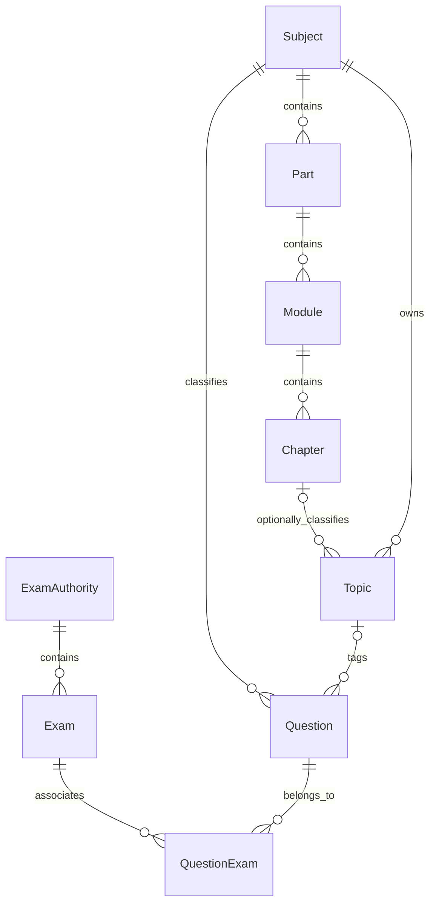

# Shared question taxonomy — 2026-11-10

Phase D2 supersedes the mandatory-chain details below with optional immediate
parents and stable taxonomy codes. See [flexible taxonomy](flexible-taxonomy.md).

Approved choices: reuse the hierarchy across exams; keep new levels optional for
existing records until administrators classify them.

WBCS is the existing **Exam**, not ExamAuthority. Example shared path:
History → India → Ancient history → Stone age → Paleolithic.
WBCS and Clerkship can reuse this path and the same question master through
QuestionExam. `exams.selectors.subjects_for_exam(exam_id)` derives associated
subjects from existing question/exam membership; no second exam/subject mapping
is introduced. Subjects without question associations are not returned by this
selector. This is question tagging, not a separate syllabus-definition system.

## Models and compatibility

- Part: Subject FK, name, slug, display_order.
- Module: Part FK, name, slug, display_order.
- Chapter: Module FK, name, slug, display_order.
- Topic retains its required Subject FK and existing identity, and adds optional
  Chapter FK. Part/Module/Chapter are derived through Chapter, not duplicated on
  Questions. A classified Topic must trace back to its own Subject.
- Question keeps its existing required Subject and optional Topic references.
  No question, revision, translation, paper association or attempt is recreated.

This Part is a subject subdivision (India/World). PreviousYearPaper.part remains
the existing paper-name metadata; these are separate concepts.

New nodes have parent-scoped slug and case-insensitive trimmed-name database
uniqueness. Classified topics additionally have chapter-scoped normalized-name
uniqueness. Existing `(subject, slug)` uniqueness remains: use distinct topic
slugs when the same name occurs in different chapters of one subject. Legacy
unclassified topics retain their names, IDs and existing uniqueness policy.

All hierarchy FKs use PROTECT. PostgreSQL triggers reject topic/chapter subject
mismatches, even in bulk/SQL writes, and prevent moving existing Part, Module,
Chapter or Topic to another parent subject/path. Rename/reorder nodes normally;
for a genuinely different path create new nodes and explicitly retag questions.
Attaching/changing a Topic's Chapter within the same Subject is allowed and does
not rewrite existing question-content snapshots. Model validation reports useful
errors before saves; database constraints remain the final integrity guard.

## Administration

Create Part under Subject, Module under Part, Chapter under Module, then choose
Chapter when creating/editing Topic. New admin screens provide search, parent
filters, slug prepopulation and Module/Chapter inlines. Topic administration and
the existing Subject topic inline allow Chapter selection. Question administration
adds Part/Module/Chapter/Topic filters; selecting a Topic applies its full path.
Existing Subject/Topic validation still rejects a question with the wrong subject.

No new mandatory fields are added to imports, Practice configuration or patterns.
Their existing Topic selections still reference these same IDs. Imports continue
to accept the established Subject/Topic columns and may create unclassified topics;
classify them in Admin afterward. Part/Module/Chapter CSV columns and a cascading
student hierarchy picker are not implemented in this change. Ambiguous same-name
topics across chapters require explicit existing-topic mapping during import;
the importer must not guess a chapter.

## Migrations, audit and history

Run `python manage.py migrate` and `python manage.py audit_taxonomy` on each host.
Migration 0002 creates the hierarchy tables and nullable Topic.chapter; all old
topics start with no Chapter. Migration 0003 installs the PostgreSQL integrity
triggers. No automatic classification, data deletion or production seed data.
Existing migrations remain unchanged. Removing the new hierarchy schema later
would discard its classifications; preserve that data before any rollback.

The audit checks Topic/Chapter subject consistency and existing Question,
PracticeSession and ExamPatternSection subject/topic links without modifying data.
Cross-table links in those older models retain their existing model/service
validation; the new triggers do not claim to enforce every legacy relation in SQL.

Historical mock/practice configuration snapshots, answers, translations and scores
are not rewritten. Taxonomy labels on live question masters remain editable metadata;
the new hierarchy is not backfilled into frozen attempt classifications.
